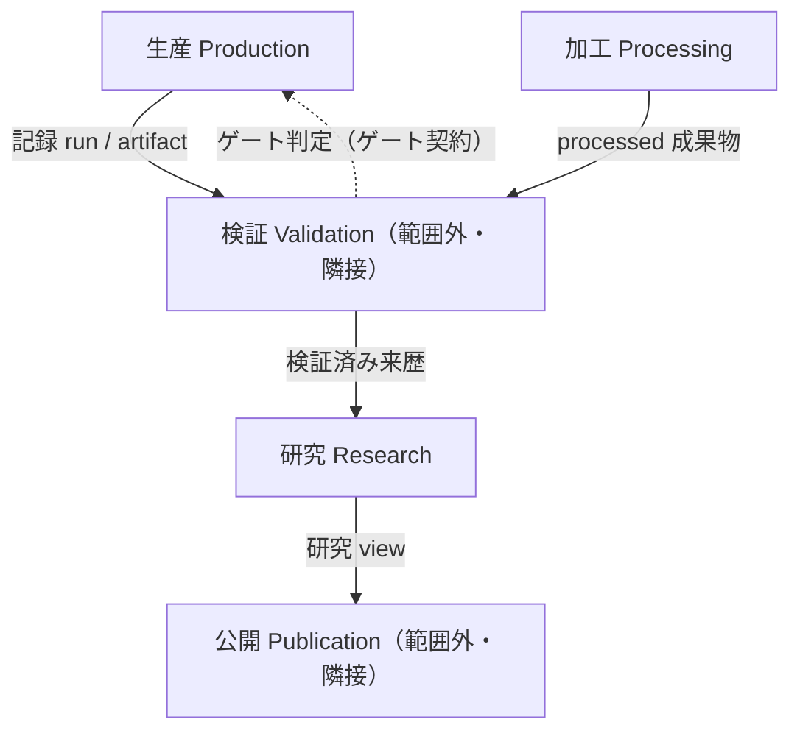

# コンテキストマップ（Context Map）

**版:** 0.1.0（草案、2026-10-16）  
**正本:** 境界の定義は `docs/specs/contracts.md` §3 の引用。本ファイルは選定キーワード4件
（生産・研究・加工・契約）の範囲の写しに、境界決定の記録を加えたもの。定義の変更は contracts.md 側で行う。  
**語彙:** `docs/domain/glossary.md`。  
**分類凡例:** Observed＝実測・引用、Proposed＝本草案の提案（要owner判断）。

## 1. 能力と候補サブドメイン

| 能力 | 候補サブドメイン | 分類 | 根拠 |
|---|---|---|---|
| 契約準拠の記録を産出する | 生産 | supporting（Proposed） | 研究の根拠となる記録の供給が役割。Repository Mission（AGENTS.md）は再現可能なデータセットの維持であり、中心的問いは研究側にある |
| 研究単位として束ね根拠づける | 研究 | core（Proposed） | Study が dataset release の根拠になる研究集約（`contracts.md` §2）。対案：生産を core とする見方（記録なくして研究なし）。要owner判断 |
| 派生値を導出・再現可能にする | 加工 | supporting（Proposed） | 生産の下位（`contracts.md` §2.1、§4 U1で解決：生産の下位に確定） |
| 版を持つ合意を宣言・検査可能にする | 契約 | generic（Proposed） | 仕組み自体は汎用（スキーマ・台帳・ゲート）。対案：本リポジトリ特化の運用（G1-G7、PC-1〜8）を理由に supporting とする見方。要owner判断 |

## 2. 境界コンテキスト

| コンテキスト | ドメインモデル（要点） | 主要な不変条件 | 検査 |
|---|---|---|---|
| 生産 | 収集 run（`collection-run-v1`）、staged run、catalog 配置、加工成果物、生成値。収集・加工を内包（Observed、§3.1） | 生産は判定しない。出力は記録であって解釈ではない（Observed、§3.1規則1・3） | 検証コンテキスト（`gate-run` / `audit-new-runs` / `audit-processed`） |
| 加工 | 派生成果物の導出宣言（`DERIVATIONS`）と生成値。`reproduce_artifact` による再導出検査が中核。生産の下位（owner決定 2026-10-16、§4 U1）（Observed） | コミット済み派生表は再導出と一致する（Observed、付録A4・`test_audit_report_freshness.py`） | `audit-processed`、`test_every_committed_artifact_is_accounted_for` |
| 研究 | Study 集約（集約ルート：`datasets/<study-id>/README.md` / `methodology.md` / `study-registry.json`）。transformation 来歴・evidence・measurement / view を束ねる（Observed、§2・§5） | 凍結 legacy 以外は現行契約を満たす（Observed、付録A3） | `research.cli audit-studies`、`validate-registries` |
| 契約 | 総称。実体はスキーマ契約・レジストリ文書・インターフェース契約・ゲート契約・判断記録と唯一の台帳。下位種別のゲート契約の所有も契約とする（owner決定 2026-10-16、§4 U2）（Observed、§8） | 新規スキーマ登録時は owner / group を省略できない（Observed、§4）。ゲート契約の版は未宣言（既知ギャップG1、§10→§4 U4） | `contract-ledger`、`test_contract_ledger.py` |

## 3. 上流／下流と統合手段（`contracts.md` §3.2 の引用）

- 上流の契約は下流にしか流れない（公開が収集の契約を書き換えない）（Observed、§3.2）。
- 統合の実体：`run_metadata.json`、artifact manifest、staging 宣言（`staging-declaration-v1`）、`contract-ledger.json`（Observed）。
- 検証・公開・保管・収集は本マップの範囲外だが、辺の相手方として記載する（削除しない）。

## 4. 境界決定の記録

| # | 問い | チェックリスト適用／説明 | 状態 |
|---|---|---|---|
| U1 | 加工を生産から独立させるか | 語彙（導出宣言・再導出）は加工固有。独立不変条件（再生成一致）あり。一方で変更ケイデンスは収集連動、調整コストは単一所有のため低い | 解決済み（2026-10-16 owner決定：独立させない。加工は生産の下） |
| U2 | ゲート契約の所有が「検証・研究」である理由 | 解決：所有は**契約**とする。ゲート契約は段階遷移の可否判定という振る舞いであり、判定の実施主体（検証CLI・研究CLI）が複数にまたがるため、実施主体を所有にすると境界が割れる。所有は種別を束ねる契約総称に置き、検証・研究は検査・行使の役割として分離する。これは `contracts.md` §4規則2（所有者と検査者が別であることを許す）と同型の分離である。なお `contracts.md` §2表のゲート契約行の所有列は「検証・研究」のままなので、正本側の同期が残件 | 解決済み（2026-10-16 owner決定）。残件：`contracts.md` §2表の所有列同期 |
| U3 | validation ↔ storage の双方向依存 | `storage_contract ↔ contracts`、`inventory → integrity`（Step 1 実測）。保管は範囲外 | 未解決（隣接事実として記録。本マップでは解消しない） |
| U4 | ゲート契約の版未宣言（G1） | 下記「## 5. バージョン（版）の定義」を参照。方針は「版が必要になった時点で付与し、推測で付けない」（`contracts.md` §10）。版が必要になる条件の例：ゲート判定の意味が変わる変更（判定条件の追加・削除）、複数版のゲートの並存が必要になった時。現状6件は単一版のみが存在し並存がないため、未宣言のまま記録するのが正しい状態である。版付与時は `contracts.md` §9手順に従い、台帳＋本マップを同時更新する | 未解決（説明補充済み。ギャップ自体は版付与まで残る） |

## 5. バージョン（版）の定義（U4の補足）

「バージョンを持つ」とは次の3点が揃うこと（Observed、コード実測）。1つでも欠ければ未宣言ギャップとして記録し、推測で補わない（`contracts.md` §10）。

1. バージョンの値が宣言場所に存在する。
2. 台帳 `contract-ledger` の `version` 列に記録される（`None` は未宣言の記録）。
3. 検査がバージョンの一致を検証する。

種別ごとのバージョンの形（Observed）：

| 種別 | バージョンの値 | 宣言場所 | 検査の例 |
|---|---|---|---|
| スキーマ契約 | `SCHEMA_VERSIONS[schema_id]` と文書の `schema_version` フィールド | `src/validation/schema_registry.py:92`、各文書 | A1（CV-20、`check_schema_version`） |
| レジストリ文書 | 文書内の `schema_version` | `config/`、`metadata/` 各文書 | `validate-registries` |
| インターフェース契約 | モジュール定数（`ADAPTER_CONTRACT_VERSION`、`STAGING_DECLARATION_VERSION` 等） | `src/collection/core/contracts.py`、`staging.py` | 各 contract test。reader 契約自体は定数なし（`version: None`、既知ギャップG2、`contract_ledger.py`） |
| ゲート契約 | なし（6件とも `version: None`、`contract_ledger.py:142`） | `src/validation/gates.py` 等（`declared_at` のみ） | CLI 自体が判定。バージョン一致の検査は存在しない |
| 収集記録のバージョン参照 | `adapter_contract_version`、`collection_core_version`、`query_registry_version` | `run_metadata.json` の environment / provenance 欄 | `audit-new-runs`（現行契約適合） |

バージョンは single source ではない。種別ごとに「値の置き場所・台帳の列・検査」が1組になって初めてバージョンとして機能する。ゲート契約にバージョンを付与するとは、この1組（定数＋台帳列＋一致検査）を新設することであり、定数だけ置くことではない。

方針：バージョンの併存を許す。移行期に新旧バージョンが並存することを前提とし、併存時は次を要求する：①台帳は各バージョンを区別して記録する ②検査は対象のバージョンを指定・検証できる ③記録（run 等）は準拠バージョンを明記する（現行の `adapter_contract_version` 等の欄が該当）。旧バージョンの廃止は別途宣言する（黙って消さない）。

注意：本§のバージョンと配布単位のリリース（glossary別項。git tag / Zenodo による配布。例 v1.13.x）は区別する。
