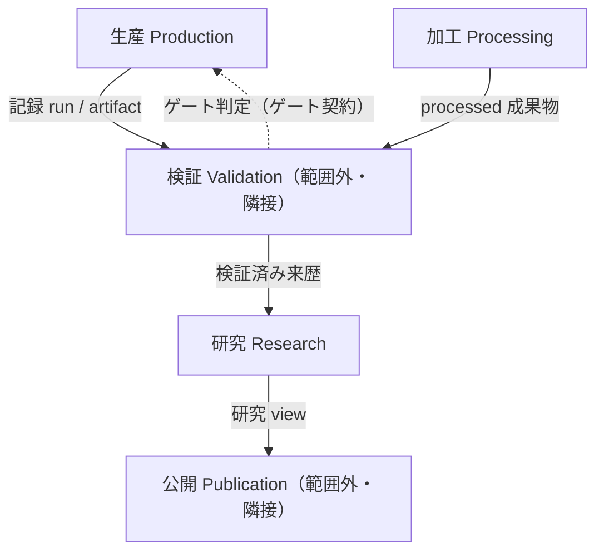

# コンテキストマップ（Context Map）

**版:** 0.1.0（草案、2026-10-16）  
**正本:** 境界の定義は `docs/specs/contracts.md` §3 の引用。本ファイルは選定キーワード4件
（生産・研究・加工・契約）の範囲の写しに、境界決定の記録を加えたもの。定義の変更は contracts.md 側で行う。  
**語彙:** `docs/domain/glossary.md`。  
**分類凡例:** Observed＝実測・引用、Proposed＝本草案の提案（要owner判断）。

## 1. 能力と候補サブドメイン

| 能力 | 候補サブドメイン | 分類 | 根拠 |
|---|---|---|---|
| 研究対象データの形成、評価、公開までのライフサイクルを管理する | 研究管理基盤 | core（owner決定 2026-10-16） | 取得・採用・加工・生成・採録などを「形成」として抽象化し、来歴・契約・検証・制約とともに再現可能な研究リリースを成立させる中核能力 |
| 契約準拠の記録を産出する | 生産 | core の構成要素 | 研究管理基盤の「形成」を担う。独立した core / supporting ではなく core 能力の内側の文脈 |
| 研究単位として束ね根拠づける | 研究 | core の構成要素 | 研究管理基盤の「評価・公開根拠」を担う。Study が dataset release の根拠になる研究集約（`contracts.md` §2） |
| 派生値を導出・再現可能にする | 加工 | 生産の下位 | 生産の下位（`contracts.md` §2.1、§4 U1で解決：生産の下位に確定） |
| 版を持つ合意を宣言・検査可能にする | 契約 | core を支える governance 基盤 | 研究管理基盤を成立させる横断的な合意・検査の仕組み。汎用性はあるが本リポジトリでは core 能力を支える必須基盤 |

## 2. 境界コンテキスト

| コンテキスト | ドメインモデル（要点） | 主要な不変条件 | 検査 |
|---|---|---|---|
| 生産 | 収集 run（`collection-run-v1`）、staged run、catalog 配置、加工成果物、生成値。収集・加工・出荷を内包（Observed、§3.1） | 生産は契約に含まれる検収条件・検証項目を評価し、契約に沿って成果物を保管先へ出荷する。判定ルール・判定理由・可否の意味は独自所有せず、契約遵守のために検証ゲートを呼び、結果をワークフロー制御として執行する（Observed、§3.1規則1・U5） | 検証コンテキスト（`gate-run` / `audit-new-runs` / `audit-processed`） |
| 加工 | 派生成果物の導出宣言（`DERIVATIONS`）と生成値。`reproduce_artifact` による再導出検査が中核。生産の下位（owner決定 2026-10-16、§4 U1）（Observed） | コミット済み派生表は再導出と一致する（Observed、付録A4・`test_audit_report_freshness.py`） | `audit-processed`、`test_every_committed_artifact_is_accounted_for` |
| 研究 | Study 集約（集約ルート：`datasets/<study-id>/README.md` / `methodology.md` / `study-registry.json`）。transformation 来歴・evidence・measurement / view を束ねる（Observed、§2・§5） | 凍結 legacy 以外は現行契約を満たす（Observed、付録A3） | `research.cli audit-studies`、`validate-registries` |
| 契約 | 総称。実体はスキーマ契約・レジストリ文書・インターフェース契約・ゲート契約・判断記録と唯一の台帳。下位種別のゲート契約の所有も契約とする（owner決定 2026-10-16、§4 U2）（Observed、§8） | 新規スキーマ登録時は owner / group を省略できない（Observed、§4）。ゲート契約の版は未宣言（既知ギャップG1、§10→§4 U4） | `contract-ledger`、`test_contract_ledger.py` |

## 3. 上流／下流と統合手段（`contracts.md` §3.2 の引用）

- 上流の契約は下流にしか流れない（公開が収集の契約を書き換えない）（Observed、§3.2）。
- 統合の実体：`run_metadata.json`、artifact manifest、staging 宣言（`staging-declaration-v1`）、`contract-ledger.json`（Observed）。
- 検証・公開・保管・収集は本マップの範囲外だが、辺の相手方として記載する（削除しない）。

## 4. 境界決定の記録

| # | 問い | チェックリスト適用／説明 | 状態 |
|---|---|---|---|
| U1 | 加工を生産から独立させるか | 語彙（導出宣言・再導出）は加工固有。独立不変条件（再生成一致）あり。一方で変更ケイデンスは収集連動、調整の負担は単一所有のため低い | 解決済み（2026-10-16 owner決定：独立させない。加工は生産の下） |
| U2 | ゲート契約の所有が「検証・研究」である理由 | 解決：所有は**契約**とする。ゲート契約は段階遷移の可否判定という振る舞いであり、判定の実施主体（検証CLI・研究CLI）が複数にまたがるため、実施主体を所有にすると境界が割れる。所有は種別を束ねる契約総称に置き、検証・研究は検査・行使の役割として分離する。これは `contracts.md` §4規則2（所有者と検査者が別であることを許す）と同型の分離である。正本側の同期は 2026-10-16 に完了（`contracts.md` §2・§2.1・§3.2・§4規則4、台帳 `GATE_CONTRACTS` の owner を `contract` に更新） | 解決済み（2026-10-16 owner決定＋正本同期完了） |
| U3 | validation ↔ storage の隣接 protocol | 方針：保管と検証は隣接する。契約は検収条件・検証項目・保管条件を含み、1契約が複数の保管対象・保管先を束ねること（1契約:多保管）を許容する。生産/出荷は契約に従い成果物を指定保管先（local / repository / remote）へ引き渡す（出荷≠リリース）。目録はどこに何が保管されているかを知るための非破壊記録であり、判定ではない。検証は保管条件が満たされているかを見るため、保管の public interface（`contracts` / `readers` / `registry` / `sniff`）と目録を読んでよい。禁止：保管・目録が gate / verdict / CLI / judgment を所有または参照すること、検証が保管物を生成・変更すること。実測の辺は `validation.storage_contract`→`storage.*`（読む側）と `storage/inventory.py`→`validation.integrity.sha256_file`（hash primitive 再利用）のみでモジュール間の閉路なし。採用ERは `docs/plan/20261016.md`（plan / adopted draft）。詳細は `docs/domain/decision-briefs/U3-validation-storage-dependency.md` §4 | 方針決定済み（2026-10-16 owner決定：隣接 protocol として正式化。コード変更なし。allowlist test は実装済み（`tests/domain/test_storage_validation_adjacency.py`）） |
| U4 | ゲート契約の版未宣言（G1） | 下記「## 5. バージョン（版）の定義」を参照。方針は「版が必要になった時点で付与し、推測で付けない」（`contracts.md` §10）。owner が正式トリガー T1–T3 を承認済み（2026-10-16、案C採用）: T1 意味変更（合否意味・必須条件・failure / warning の扱い変更）、T2 並存（同一 gate 名の複数判定基準の同時保持・実行・参照）、T3 引用（外部公開・DOI・論文・第三者監査での固定識別子引用の必要）。現状はいずれも不成立。いずれかが成立した場合は owner が版付与を再判断する。現状7件は単一版のみが存在し並存がないため、未宣言のまま記録するのが正しい状態である。版付与時は `contracts.md` §9手順に従い、台帳＋本マップを同時更新する。正式トリガーの定義は `docs/domain/decision-briefs/U4-gate-contract-version.md` §3 | 方針決定済み（2026-10-16 owner決定：案C採用。G1 は意図的に open の既知ギャップとして残す） |
| U5 | 生産の検収と pre/post-collection gate 呼び出しの関係 | 解決：生産（パイプライン）は契約に従って実行される責務を持ち、契約に含まれる検収条件・検証項目を評価する。生産は判定ルール・判定理由・可否の意味を独自所有しないが、契約遵守のために検証ゲートを呼び、その結果をワークフロー制御として執行しなければならない。禁止された手法・迂回経路・raw改変・未宣言採用による生産・出荷は不可。したがって `pre_collection_gate` / `post_collection_gate` 呼び出しは、契約に沿う検収・出荷制御であり、判定ルールの所有ではない | 解決済み（2026-10-16 owner決定、2026-10-16用語更新）。境界テストT1は、検証ゲートが生産コードに依存しないP5方向を検査する。逆方向の gate 呼び出しは許可される |

## 5. バージョン（版）の定義（U4の補足）

「バージョンを持つ」とは次の3点が揃うこと（Observed、コード実測）。1つでも欠ければ未宣言ギャップとして記録し、推測で補わない（`contracts.md` §10）。

1. バージョンの値が宣言場所に存在する。
2. 台帳 `contract-ledger` の `version` 列に記録される（`None` は未宣言の記録）。
3. 検査がバージョンの一致を検証する。

種別ごとのバージョンの形（Observed）：

| 種別 | バージョンの値 | 宣言場所 | 検査の例 |
|---|---|---|---|
| スキーマ契約 | `SCHEMA_VERSIONS[schema_id]` と文書の `schema_version` フィールド | `src/validation/schema_registry.py:92`、各文書 | A1（CV-20、`check_schema_version`） |
| レジストリ文書 | 文書内の `schema_version` | `config/`、`metadata/` 各文書 | `validate-registries` |
| インターフェース契約 | モジュール定数（`ADAPTER_CONTRACT_VERSION`、`STAGING_DECLARATION_VERSION` 等） | `src/collection/core/contracts.py`、`staging.py` | 各 contract test。reader 契約自体は定数なし（`version: None`、既知ギャップG2、`contract_ledger.py`） |
| ゲート契約 | なし（7件とも `version: None`、`contract_ledger.py:147`） | `src/validation/gates.py` 等（`declared_at` のみ） | CLI 自体が判定。バージョン一致の検査は存在しない |
| 収集記録のバージョン参照 | `adapter_contract_version`、`collection_core_version`、`query_registry_version` | `run_metadata.json` の environment / provenance 欄 | `audit-new-runs`（現行契約適合） |

バージョンは single source ではない。種別ごとに「値の置き場所・台帳の列・検査」が1組になって初めてバージョンとして機能する。ゲート契約にバージョンを付与するとは、この1組（定数＋台帳列＋一致検査）を新設することであり、定数だけ置くことではない。

方針：バージョンの併存を許す。移行期に新旧バージョンが並存することを前提とし、併存時は次を要求する：①台帳は各バージョンを区別して記録する ②検査は対象のバージョンを指定・検証できる ③記録（run 等）は準拠バージョンを明記する（現行の `adapter_contract_version` 等の欄が該当）。旧バージョンの廃止は別途宣言する（黙って消さない）。

注意：本§のバージョンと配布単位のリリース（glossary別項。git tag / Zenodo による配布。例 v1.13.x）は区別する。リリースするから gate version が必要になるわけではない。

U4 正式方針（owner決定 2026-10-16、案C）: ゲート契約の版は未宣言のまま維持し、G1 は意図的に open の既知ギャップとして残す。正式トリガー T1 意味変更／T2 並存／T3 引用のいずれか成立時に owner が版付与を再判断する。トリガーの定義は本マップ §4 U4、全文は `docs/domain/decision-briefs/U4-gate-contract-version.md` §3。
