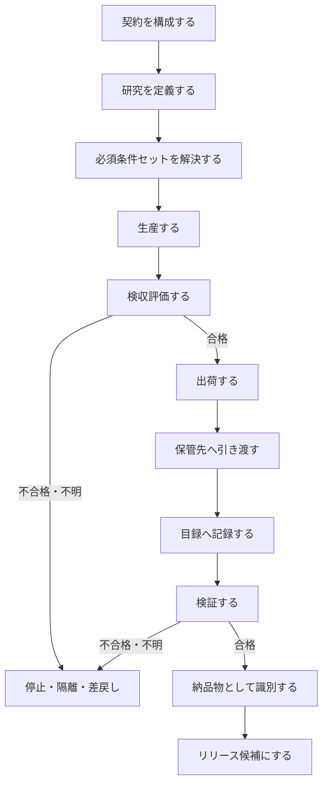

# 2026-10-16 plan — 採用済み ER 図を補完する手続き（algorithm draft）

**状態:** 草案（2026-10-16）。本ファイルは `docs/plan/20261016.md` の採用済み ER 図を補完する plan / algorithm draft であり、正式仕様ではない。  
**用途:** ER 図が示す「関係」を、実務上の「手続き」として読めるように整理する。正本化する場合は `docs/specs/contracts.md`、`docs/domain/context-map.md`、`docs/domain/glossary.md`、各コンテキスト契約へ同期する。  
**非目的:** 本書は新しい gate、schema、release 手順、publication 承認を追加しない。raw / interim / processed / publication データを変更しない。

## 1. 全体像

ER 図は次の流れを前提にする。

1. **契約**が、規約・法令枠組み・第三者制約を取り込み、検収条件・検証項目・保管条件を定義する。
2. **研究**が、契約に統治され、制約・研究質問・生産を束ねる。
3. **生産**が、中間成果物・成果物を生成し、契約に沿って検収評価を行う。
4. **出荷**が、契約に従い、成果物を指定された保管先へ引き渡す。
5. **保管**が、成果物を保管し、目録を維持する。
6. **検証**が、成果物・検証項目・保管条件・目録を確認し、検証結果を産出する。
7. **納品物**は検証を通過した成果物として version で識別される。
8. **リリース**は、出荷済みの納品物を配布単位として packaged / distributed する。



## 1.1. 必須条件セットのモデル

ER 図では、契約が検収条件・検証項目・保管条件を定義する。ただし、実際のタスクや成果物で「どの条件が必須か」は、契約の総体だけでは決まらない。研究、成果物の種類、保管先、公開可否、第三者制約に応じて、タスクごとに必須条件セットを解決する必要がある。

**必須条件セット（Required Condition Set）** は、タスクまたは成果物を次工程へ進めるために満たす必要がある参照集合である。

| 種別 | 由来 | 主に評価・検査する側 | 次工程を止める例 |
|---|---|---|---|
| required acceptance condition | 契約の検収条件 | 生産 / 検収評価 | 収集失敗、採用不可、処理不足、private artifact の誤分類 |
| required validation item | 契約の検証項目 | 検証 | schema 不一致、hash 不一致、publication review 未了 |
| required storage condition | 契約の保管条件 | 出荷 / 保管 / 検証 | 保管先未解決、private artifact の公開保管、目録欠落 |

必須条件セットは本文の正本ではない。正本は契約・研究計画・issue / task / plan の Markdown 等に置き、実装が索引を持つ場合も `ref`、`source_doc_path`、`source_doc_sha256` のような参照だけを持つ。

**不変条件**

- 「1 件でも pass がある」ことは十分条件ではない。
- 次工程へ進むには、その工程に必要な required refs がすべて `pass` または owner 承認つき `waived` でなければならない。
- `unknown`、`missing`、`partial`、`failed` は pass とみなさない。
- `waived` は条件を消すことではない。owner、理由、根拠文書 path、時刻を残す。
- 必須条件セットを解決できない場合は、推測で進めず `unknown` として停止または owner 判断へ送る。

**擬似コード**

```text
required_set = resolve_required_condition_set(contract, study, artifact_plan)

assert required_set.acceptance_conditions is not empty when production output is expected
assert required_set.validation_items is not empty when deliverable is expected
assert required_set.storage_conditions is not empty when shipping is expected

for ref in required_set:
    assert ref.source_doc_path is not empty
    assert ref.ref is not empty
```

## 1.2. fail / quarantine / replan の基本モデル

どの工程でも、不正確な出荷・公開・リリースへ進みそうな兆候を見つけたら fail-closed にする。段階が後ろであるほど安全側に倒す必要があるため、隔離は「出荷前だけ」の操作ではない。

| 操作 | 意味 | 使う場面 |
|---|---|---|
| fail | 条件を満たさないことが確認された | schema 不一致、必須条件不合格、収集失敗 |
| quarantine | 安全・権利・privacy・来歴・保管条件の疑義により、通常経路から隔離する | private/restricted 疑い、誤出荷疑い、source 不明、保管先誤り |
| replan | 失敗・隔離された作業を同じ履歴に戻さず、後続作業として計画し直す | owner が再作業を承認した場合 |

**不変条件**

- 非終端のどの工程からでも fail / quarantine できる。
- fail / quarantine した作業は、同じ履歴を巻き戻して再開しない。
- 再開が必要な場合は、owner 承認つきで後続作業を新規に作り、前後関係（supersedes / superseded-by）を記録する。
- 隔離はデータ削除ではない。raw や既存成果物を修正せず、以降の出荷・検証完了・納品物化・リリース候補化を止める。
- closed / released 相当の終端状態からの訂正は、本書のタスク再計画ではなく、公開・リリースの訂正手続きで扱う。

**擬似コード**

```text
if unsafe_or_inaccurate_condition_detected(work):
    quarantine(work, reason_ref, detected_at, detected_by)
    block_shipping_validation_deliverable_release(work)

if owner_approves_rework(quarantined_or_failed_work):
    follow_up = create_new_work(
        source_ref=owner_approval_ref,
        supersedes=quarantined_or_failed_work.id,
    )
    plan(follow_up)
```

## 2. 手続きA: 契約を構成する

**入力**

- 規約（Terms of Service）
- 法令枠組み（Legal Framework）
- 第三者制約（Third-party Constraint）
- 研究目的・研究質問の候補
- 保管・公開・再配布上の制約

**出力**

- 検収条件（Acceptance Condition）
- 検証項目（Validation Item）
- 保管条件（Storage Condition）
- 必要なら手動検証 / 自動検証の区分
- 必須条件セットを解決するための参照可能な条件 ID / notation / path

**手順**

1. 第三者・プラットフォーム・API ごとに、利用規約と再配布条件を列挙する。
2. 研究対象地域・公開先・保管先に関係する法令枠組みを列挙する。
3. 研究上の制約と、第三者制約・法令制約を分けて記録する。
4. 契約に含める条件を 3 種に分類する。
   - **検収条件:** 成果物を次工程へ進めてよいか。
   - **検証項目:** 何を検査・監査するか。
   - **保管条件:** 何を、どこに、どう保管し、どう追跡可能にするか。
5. 各条件を後続手続きから参照できる粒度に分け、ID / notation / path を持たせる。
6. 各条件について、評価主体を明確にする。
   - 生産が評価する項目。
   - 検証が検査する項目。
   - 人間の判断を要する項目。
7. 条件が必須になる範囲を記録する。
   - すべての成果物に必須。
   - 特定の artifact 種別だけに必須。
   - 特定の保管先だけに必須。
   - 公開・リリース候補だけに必須。
8. 不明な条件は推測で埋めず、未確定または owner 判断待ちとして残す。

**不変条件**

- 契約は条件の source of truth である。
- 契約は条件を参照可能な単位に分ける。
- 生産は契約に従って評価するが、判定ルール・理由・可否の意味を独自所有しない。
- 保管条件は契約に含まれる。保管コンテキストが契約そのものを所有するわけではない。

## 3. 手続きB: 研究を定義する

**入力**

- 契約
- 研究質問
- 対象範囲
- 制約

**出力**

- Study
- Study Question
- Analysis 方針
- Production の開始条件
- タスク / 成果物単位の必須条件セット

**手順**

1. 研究単位（Study）を定義する。
2. 研究質問を、観測・派生・解釈のいずれにも混同しない形で記述する。
3. 研究の制約を列挙する。
   - 規約由来の制約
   - 法令由来の制約
   - 第三者制約
   - プライバシー・再配布制約
   - 技術的制約
4. 研究質問が必要とする分析を定義する。
5. 生産・出荷・検証・納品物化の各段階で必要な条件を、契約からタスク / 成果物単位へ割り当てる。
6. Production を開始してよい前提条件を契約と必須条件セットに照合する。
7. 必須条件セットを解決できない場合は Production を開始せず、owner 判断へ送る。

**不変条件**

- 研究質問は結論ではない。
- Analysis は raw を変更しない。
- Study は dataset release の根拠になるが、release そのものではない。
- 必須条件セットは、研究・成果物・保管先・公開可否に依存して決まる。

## 4. 手続きC: 生産する

**入力**

- 契約
- Study
- 必須条件セット
- 収集・加工対象
- 制約

**出力**

- Intermediate Artifact
- Artifact
- Acceptance Evaluation

**手順**

1. 生産対象が契約・研究制約に含まれていることを確認する。
2. 生産対象に必要な required acceptance conditions を解決する。
3. 必要な入力を収集または採用する。
   - raw は immutable として扱う。
   - 外部取得 payload は staging declaration を通じて採用する。
4. 中間成果物を生成する。
5. 中間成果物から成果物を生成する。
6. 成果物ごとに required acceptance conditions をすべて評価する。
7. 評価結果を記録する。
8. 不合格・不明・partial・collection_failed を、観測ゼロと混同しない。
9. required acceptance conditions がすべて pass / waived でない場合、出荷準備へ進めない。

**擬似コード**

```text
for study in studies:
    contract = resolve_contract(study)
    constraints = contract.constraints + study.constraints
    required_set = resolve_required_condition_set(contract, study)

    assert production_scope_is_declared(study, contract)
    assert required_set.acceptance_conditions

    inputs = collect_or_adopt_inputs(study, contract)
    preserve_raw(inputs.raw)

    intermediate_artifacts = transform_to_interim(inputs, contract)
    artifacts = produce_artifacts(intermediate_artifacts, contract)

    for artifact in artifacts:
        evaluations = []

        for condition in required_set.acceptance_conditions_for(artifact):
            evaluation = evaluate_acceptance(artifact, condition)
            record(evaluation)
            evaluations.append(evaluation)

        if not all_pass_or_waived(evaluations):
            stop_or_quarantine(artifact, evaluations)
        else:
            prepare_shipping(artifact, contract, required_set)
```

**不変条件**

- 生産は成果物を作る。
- 生産は契約の検収条件・検証項目を評価する。
- 生産は required acceptance conditions の完了を確認してから出荷準備へ進める。
- 生産は gate / verdict の意味を独自に作らない。
- raw を成功結果に合わせて編集しない。

## 5. 手続きD: 出荷する

**入力**

- Artifact
- Acceptance Evaluation
- Contract
- Storage Condition
- Storage Target
- 必須条件セット

**出力**

- Shipping record または shipping-ready 状態
- 保管先への引き渡し

**手順**

1. 成果物が検収条件を満たしていることを確認する。
2. required acceptance conditions がすべて pass / waived であることを確認する。
3. 契約から required storage conditions を解決する。
4. 保管先を解決する。
   - local
   - repository
   - remote
5. 保管先が成果物の性質に適合することを確認する。
   - private / restricted artifact を public repository や public release に置かない。
   - DOI 付与が未確定なら DOI を metadata に書かない。
6. required storage conditions をすべて評価または解決する。
7. required storage conditions がすべて pass / waived でない場合、出荷せず停止または隔離する。
8. 成果物を保管先へ引き渡す。
9. 目録に記録できる最小情報を残す。

**不変条件**

- 出荷はリリースではない。
- 出荷は成果物を指定保管先へ引き渡す工程である。
- 出荷は required acceptance conditions と required storage conditions が満たされた後にだけ行う。
- リリースは、出荷済みの納品物を配布単位として公開する別工程である。

## 6. 手続きE: 保管し、目録を維持する

**入力**

- Artifact
- Storage Target
- Storage Condition
- 必須条件セット

**出力**

- 保管済み Artifact
- Inventory

**手順**

1. 保管対象を受け取る。
2. 保管先に配置する。
3. required storage conditions に対応する記録項目を確認する。
4. 目録に次を記録する。
   - artifact
   - storage target
   - path / location
   - size
   - sha256 などの非破壊照合情報
   - format
   - tracked / ignored / local-only などの追跡状態
5. required storage conditions の確認に必要な目録項目が欠けている場合は、検証完了へ進めず unknown / missing として扱う。
6. 目録は成果物の内容を修正しない。
7. 目録は採用・公開・研究解釈の判定をしない。

**不変条件**

- 保管は成果物を保持する。
- 目録は「どこに何があるか」を記録する。
- 目録は required storage conditions の検査に必要な事実を非破壊に記録する。
- 目録は gate / verdict / judgment を所有しない。
- 保管は検証から読まれてよい public interface を持つ。

## 7. 手続きF: 検証する

**入力**

- Artifact
- Validation Item
- Storage Condition
- Inventory
- Contract
- 必須条件セット

**出力**

- Validation Result

**手順**

1. 対象 artifact と契約を解決する。
2. 対象 artifact の required validation items を列挙する。
3. 対象 artifact の required storage conditions を列挙する。
4. 目録を読み、保管先・path・hash・format・追跡状態を確認する。
5. 目録が required storage conditions の確認に必要な事実を持つことを確認する。
6. 自動検証できる required validation items を実行する。
7. 手動検証が必要な required validation items を owner / reviewer に委ねる。
8. required validation items と required storage conditions の結果を記録する。
9. required validation items / storage conditions がすべて pass / waived でない場合、検証完了・納品物化・リリース候補化へ進めない。

**擬似コード**

```text
for artifact in artifacts:
    contract = resolve_contract(artifact)
    required_set = resolve_required_condition_set(contract, artifact.study)
    inventory_record = inventory.lookup(artifact)

    results = []

    for item in required_set.validation_items_for(artifact):
        if item.mode == "automated":
            results.append(run_automated_check(item, artifact, inventory_record))
        else:
            results.append(request_manual_review(item, artifact, inventory_record))

    for condition in required_set.storage_conditions_for(artifact):
        results.append(check_storage_condition(condition, inventory_record))

    validation_result = summarize(results)
    record(validation_result)

    if not all_pass_or_waived(results):
        block_release(artifact, validation_result)
```

**不変条件**

- 検証は保管物を生成・変更しない。
- 検証は保管の public interface と目録を読んでよい。
- 検証結果は artifact の source of truth ではない。
- 検証項目と保管条件の意味は契約に従う。
- 検証完了には required validation items と required storage conditions がすべて pass / waived であることが必要である。

## 8. 手続きG: 納品物として識別し、リリース候補にする

**入力**

- Artifact
- Validation Result
- Version policy
- Shipping state
- 必須条件セット

**出力**

- Deliverable
- Version
- Release candidate

**手順**

1. artifact が検証を通過していることを確認する。
2. required validation items と required storage conditions がすべて pass / waived であることを確認する。
3. artifact が出荷済みまたは出荷可能であることを確認する。
4. artifact が公開・配布してよい性質か確認する。
   - private / sensitive / third-party restricted data は除外または aggregated / derived へ限定する。
5. deliverable として識別する。
6. version を付与または参照する。
7. release candidate に含める。
8. publication gate / release gate を通過するまで release しない。

**不変条件**

- すべての artifact が deliverable になるわけではない。
- deliverable は検証済み artifact の部分集合である。
- deliverable 化には required validation items / storage conditions の pass / waived が必要である。
- release は配布行為であり、version そのものではない。
- release は shipping に依存するが、shipping と同義ではない。

## 9. 失敗・不明・差戻しの扱い

| 状態 | 意味 | 次の扱い |
|---|---|---|
| pass | 条件を満たす | 次工程へ進めてよい |
| fail | 条件を満たさない | 停止、差戻し、quarantine |
| unknown | 判断に必要な情報がない | 推測で進めない。owner 判断または追加収集 |
| partial | 一部だけ成功 | 成功部分と失敗部分を分け、選択規則を明示 |
| collection_failed | 収集失敗 | observed_zero に変換しない |
| observed_zero | 観測対象がゼロ件であることを観測した | missing / failed と区別する |
| missing | あるべき情報がない | 欠損として記録し、補完しない |
| waived | owner が根拠つきで必須条件の例外を承認した | 条件を削除せず、owner・理由・根拠 path・時刻を記録する |
| quarantined | 安全・権利・privacy・来歴・保管条件の疑義で通常経路から隔離した | 同じ作業を巻き戻さず、再開時は後続作業を新規作成する |

fail / quarantine はどの非終端工程でも発生し得る。出荷済み・検証済み・納品物化直前であっても、private / restricted / provenance 不明などの疑義が見つかった場合は、以降の出荷・検証完了・納品物化・リリース候補化を止める。

## 10. コンテキスト別の責務

| コンテキスト / 要素 | 主な責務 | してはいけないこと |
|---|---|---|
| 契約 | 検収条件・検証項目・保管条件を定義する | 未確認条件を fabricated value で埋める |
| 研究 | 研究質問・制約・分析方針を束ねる | 解釈を観測事実として扱う |
| 生産 | 成果物を生成し、契約に沿って検収評価する | 判定ルール・理由・可否の意味を独自所有する |
| 出荷 | 成果物を指定保管先へ引き渡す | release / publication と混同する |
| 保管 | 成果物を保持し、読み取り・追跡可能性を支える | gate / verdict / judgment を所有する |
| 目録 | 保管先・path・hash 等を非破壊に記録する | 成果物を修正する、採否を判定する |
| 検証 | 検証項目・保管条件を検査し、検証結果を出す | 収集・加工成果物を産出する |
| 納品物 | 検証済み artifact として識別される | private / restricted artifact を自動的に公開対象にする |
| リリース | 納品物を配布単位として公開する | DOI 未割当の状態で DOI を metadata に書く |

## 11. 実装・文書化するときのチェックリスト

1. ER のどの関係を実装または文書化するのかを明示したか。
2. その関係の owner が契約・生産・保管・検証・研究・公開のどれかを明示したか。
3. 契約条件・検収条件・検証項目・保管条件を混同していないか。
4. タスク / 成果物単位の必須条件セットを解決したか。
5. 「1 件でも pass」ではなく、必要な required refs がすべて pass / waived であることを確認したか。
6. `waived` を使う場合、owner・理由・根拠 path・時刻を記録したか。
7. 生産の「評価」と、検証 / gate の「判定意味の所有」を混同していないか。
8. 出荷とリリースを混同していないか。
9. 保管先が local / repository / remote のどれかを明示したか。
10. 目録が非破壊記録であり、判定ではないことを保ったか。
11. raw を編集していないか。
12. missing / failed / observed_zero を混同していないか。
13. fail / quarantine をどの非終端工程でも記録できるようにしたか。
14. failed / quarantined 作業を巻き戻さず、再開時は owner 承認つき後続作業として扱ったか。
15. publication / release に進める前に gate と review が必要であることを残したか。

## 12. 正本化候補

本書を正式仕様へ昇格する場合、次を owner 判断で分割して移す。

| 候補 | 移し先 | 備考 |
|---|---|---|
| 契約構成手続き | `docs/specs/contracts.md` | 検収条件・検証項目・保管条件の扱い |
| 生産・検収評価手続き | `docs/domain/contracts/production.md` | U5 と整合させる |
| 出荷手続き | `docs/domain/contracts/production.md` または新規 contract | release との差分を維持 |
| 保管・目録手続き | storage contract / domain docs | U3 allowlist と整合させる |
| 検証手続き | validation framework | 検証項目・保管条件・目録の読み方 |
| release 候補化 | release-process / publication docs | publication gate と接続する |
