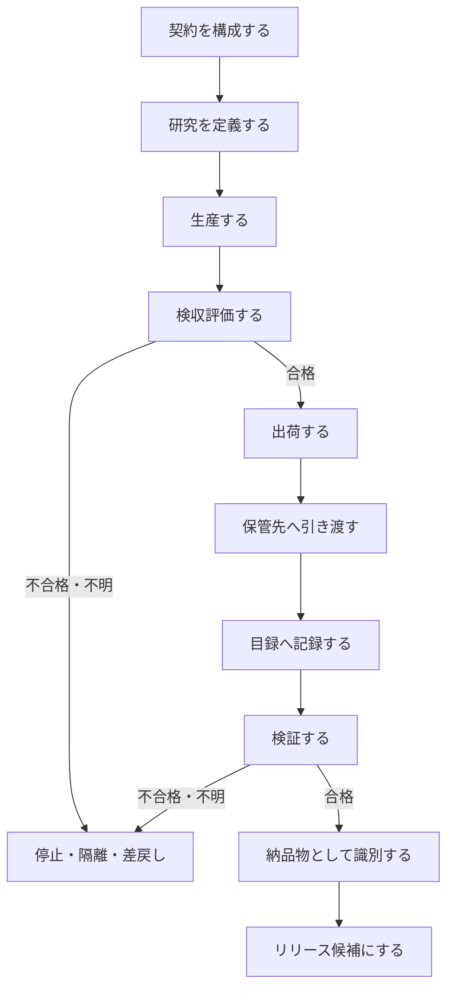

# 2026-10-16 plan — 採用済み ER 図を補完する手続き（algorithm draft）

**状態:** 草案（2026-10-16）。本ファイルは `docs/plan/20261016.md` の採用済み ER 図を補完する plan / algorithm draft であり、正式仕様ではない。  
**用途:** ER 図が示す「関係」を、実務上の「手続き」として読めるように整理する。正本化する場合は `docs/specs/contracts.md`、`docs/domain/context-map.md`、`docs/domain/glossary.md`、各コンテキスト契約へ同期する。  
**非目的:** 本書は新しい gate、schema、release 手順、publication 承認を追加しない。raw / interim / processed / publication データを変更しない。

## 1. 全体像

ER 図は次の流れを前提にする。

1. **契約**が、規約・法令枠組み・第三者制約を取り込み、検収条件・検証項目・保管条件を定義する。
2. **研究**が、契約に統治され、制約・研究質問・生産を束ねる。
3. **生産**が、中間成果物・成果物を生成し、契約に沿って検収評価を行う。
4. **出荷**が、契約に従い、成果物を指定された保管先へ引き渡す。
5. **保管**が、成果物を保管し、目録を維持する。
6. **検証**が、成果物・検証項目・保管条件・目録を確認し、検証結果を産出する。
7. **納品物**は検証を通過した成果物として version で識別される。
8. **リリース**は、出荷済みの納品物を配布単位として packaged / distributed する。



## 2. 手続きA: 契約を構成する

**入力**

- 規約（Terms of Service）
- 法令枠組み（Legal Framework）
- 第三者制約（Third-party Constraint）
- 研究目的・研究質問の候補
- 保管・公開・再配布上の制約

**出力**

- 検収条件（Acceptance Condition）
- 検証項目（Validation Item）
- 保管条件（Storage Condition）
- 必要なら手動検証 / 自動検証の区分

**手順**

1. 第三者・プラットフォーム・API ごとに、利用規約と再配布条件を列挙する。
2. 研究対象地域・公開先・保管先に関係する法令枠組みを列挙する。
3. 研究上の制約と、第三者制約・法令制約を分けて記録する。
4. 契約に含める条件を 3 種に分類する。
   - **検収条件:** 成果物を次工程へ進めてよいか。
   - **検証項目:** 何を検査・監査するか。
   - **保管条件:** 何を、どこに、どう保管し、どう追跡可能にするか。
5. 各条件について、評価主体を明確にする。
   - 生産が評価する項目。
   - 検証が検査する項目。
   - 人間の判断を要する項目。
6. 不明な条件は推測で埋めず、未確定または owner 判断待ちとして残す。

**不変条件**

- 契約は条件の source of truth である。
- 生産は契約に従って評価するが、判定ルール・理由・可否の意味を独自所有しない。
- 保管条件は契約に含まれる。保管コンテキストが契約そのものを所有するわけではない。

## 3. 手続きB: 研究を定義する

**入力**

- 契約
- 研究質問
- 対象範囲
- 制約

**出力**

- Study
- Study Question
- Analysis 方針
- Production の開始条件

**手順**

1. 研究単位（Study）を定義する。
2. 研究質問を、観測・派生・解釈のいずれにも混同しない形で記述する。
3. 研究の制約を列挙する。
   - 規約由来の制約
   - 法令由来の制約
   - 第三者制約
   - プライバシー・再配布制約
   - 技術的制約
4. 研究質問が必要とする分析を定義する。
5. Production を開始してよい前提条件を契約と照合する。

**不変条件**

- 研究質問は結論ではない。
- Analysis は raw を変更しない。
- Study は dataset release の根拠になるが、release そのものではない。

## 4. 手続きC: 生産する

**入力**

- 契約
- Study
- 収集・加工対象
- 制約

**出力**

- Intermediate Artifact
- Artifact
- Acceptance Evaluation

**手順**

1. 生産対象が契約・研究制約に含まれていることを確認する。
2. 必要な入力を収集または採用する。
   - raw は immutable として扱う。
   - 外部取得 payload は staging declaration を通じて採用する。
3. 中間成果物を生成する。
4. 中間成果物から成果物を生成する。
5. 成果物ごとに検収条件・検証項目を評価する。
6. 評価結果を記録する。
7. 不合格・不明・partial・collection_failed を、観測ゼロと混同しない。

**擬似コード**

```text
for study in studies:
    contract = resolve_contract(study)
    constraints = contract.constraints + study.constraints

    assert production_scope_is_declared(study, contract)

    inputs = collect_or_adopt_inputs(study, contract)
    preserve_raw(inputs.raw)

    intermediate_artifacts = transform_to_interim(inputs, contract)
    artifacts = produce_artifacts(intermediate_artifacts, contract)

    for artifact in artifacts:
        evaluation = evaluate_acceptance(artifact, contract)
        record(evaluation)

        if evaluation.status in {"failed", "unknown", "partial"}:
            stop_or_quarantine(artifact, evaluation)
        else:
            prepare_shipping(artifact, contract)
```

**不変条件**

- 生産は成果物を作る。
- 生産は契約の検収条件・検証項目を評価する。
- 生産は gate / verdict の意味を独自に作らない。
- raw を成功結果に合わせて編集しない。

## 5. 手続きD: 出荷する

**入力**

- Artifact
- Acceptance Evaluation
- Contract
- Storage Condition
- Storage Target

**出力**

- Shipping record または shipping-ready 状態
- 保管先への引き渡し

**手順**

1. 成果物が検収条件を満たしていることを確認する。
2. 契約から該当する保管条件を解決する。
3. 保管先を解決する。
   - local
   - repository
   - remote
4. 保管先が成果物の性質に適合することを確認する。
   - private / restricted artifact を public repository や public release に置かない。
   - DOI 付与が未確定なら DOI を metadata に書かない。
5. 成果物を保管先へ引き渡す。
6. 目録に記録できる最小情報を残す。

**不変条件**

- 出荷はリリースではない。
- 出荷は成果物を指定保管先へ引き渡す工程である。
- リリースは、出荷済みの納品物を配布単位として公開する別工程である。

## 6. 手続きE: 保管し、目録を維持する

**入力**

- Artifact
- Storage Target
- Storage Condition

**出力**

- 保管済み Artifact
- Inventory

**手順**

1. 保管対象を受け取る。
2. 保管先に配置する。
3. 目録に次を記録する。
   - artifact
   - storage target
   - path / location
   - size
   - sha256 などの非破壊照合情報
   - format
   - tracked / ignored / local-only などの追跡状態
4. 目録は成果物の内容を修正しない。
5. 目録は採用・公開・研究解釈の判定をしない。

**不変条件**

- 保管は成果物を保持する。
- 目録は「どこに何があるか」を記録する。
- 目録は gate / verdict / judgment を所有しない。
- 保管は検証から読まれてよい public interface を持つ。

## 7. 手続きF: 検証する

**入力**

- Artifact
- Validation Item
- Storage Condition
- Inventory
- Contract

**出力**

- Validation Result

**手順**

1. 対象 artifact と契約を解決する。
2. 契約に含まれる検証項目を列挙する。
3. 保管条件を列挙する。
4. 目録を読み、保管先・path・hash・format・追跡状態を確認する。
5. 自動検証できる項目を実行する。
6. 手動検証が必要な項目を owner / reviewer に委ねる。
7. 検証結果を記録する。
8. 検証結果が不合格・不明の場合、出荷・リリースを進めない。

**擬似コード**

```text
for artifact in artifacts:
    contract = resolve_contract(artifact)
    inventory_record = inventory.lookup(artifact)

    results = []

    for item in contract.validation_items:
        if item.mode == "automated":
            results.append(run_automated_check(item, artifact, inventory_record))
        else:
            results.append(request_manual_review(item, artifact, inventory_record))

    for condition in contract.storage_conditions:
        results.append(check_storage_condition(condition, inventory_record))

    validation_result = summarize(results)
    record(validation_result)

    if validation_result.status != "pass":
        block_release(artifact, validation_result)
```

**不変条件**

- 検証は保管物を生成・変更しない。
- 検証は保管の public interface と目録を読んでよい。
- 検証結果は artifact の source of truth ではない。
- 検証項目と保管条件の意味は契約に従う。

## 8. 手続きG: 納品物として識別し、リリース候補にする

**入力**

- Artifact
- Validation Result
- Version policy
- Shipping state

**出力**

- Deliverable
- Version
- Release candidate

**手順**

1. artifact が検証を通過していることを確認する。
2. artifact が出荷済みまたは出荷可能であることを確認する。
3. artifact が公開・配布してよい性質か確認する。
   - private / sensitive / third-party restricted data は除外または aggregated / derived へ限定する。
4. deliverable として識別する。
5. version を付与または参照する。
6. release candidate に含める。
7. publication gate / release gate を通過するまで release しない。

**不変条件**

- すべての artifact が deliverable になるわけではない。
- deliverable は検証済み artifact の部分集合である。
- release は配布行為であり、version そのものではない。
- release は shipping に依存するが、shipping と同義ではない。

## 9. 失敗・不明・差戻しの扱い

| 状態 | 意味 | 次の扱い |
|---|---|---|
| pass | 条件を満たす | 次工程へ進めてよい |
| fail | 条件を満たさない | 停止、差戻し、quarantine |
| unknown | 判断に必要な情報がない | 推測で進めない。owner 判断または追加収集 |
| partial | 一部だけ成功 | 成功部分と失敗部分を分け、選択規則を明示 |
| collection_failed | 収集失敗 | observed_zero に変換しない |
| observed_zero | 観測対象がゼロ件であることを観測した | missing / failed と区別する |
| missing | あるべき情報がない | 欠損として記録し、補完しない |

## 10. コンテキスト別の責務

| コンテキスト / 要素 | 主な責務 | してはいけないこと |
|---|---|---|
| 契約 | 検収条件・検証項目・保管条件を定義する | 未確認条件を fabricated value で埋める |
| 研究 | 研究質問・制約・分析方針を束ねる | 解釈を観測事実として扱う |
| 生産 | 成果物を生成し、契約に沿って検収評価する | 判定ルール・理由・可否の意味を独自所有する |
| 出荷 | 成果物を指定保管先へ引き渡す | release / publication と混同する |
| 保管 | 成果物を保持し、読み取り・追跡可能性を支える | gate / verdict / judgment を所有する |
| 目録 | 保管先・path・hash 等を非破壊に記録する | 成果物を修正する、採否を判定する |
| 検証 | 検証項目・保管条件を検査し、検証結果を出す | 収集・加工成果物を産出する |
| 納品物 | 検証済み artifact として識別される | private / restricted artifact を自動的に公開対象にする |
| リリース | 納品物を配布単位として公開する | DOI 未割当の状態で DOI を metadata に書く |

## 11. 実装・文書化するときのチェックリスト

1. ER のどの関係を実装または文書化するのかを明示したか。
2. その関係の owner が契約・生産・保管・検証・研究・公開のどれかを明示したか。
3. 契約条件・検収条件・検証項目・保管条件を混同していないか。
4. 生産の「評価」と、検証 / gate の「判定意味の所有」を混同していないか。
5. 出荷とリリースを混同していないか。
6. 保管先が local / repository / remote のどれかを明示したか。
7. 目録が非破壊記録であり、判定ではないことを保ったか。
8. raw を編集していないか。
9. missing / failed / observed_zero を混同していないか。
10. publication / release に進める前に gate と review が必要であることを残したか。

## 12. 正本化候補

本書を正式仕様へ昇格する場合、次を owner 判断で分割して移す。

| 候補 | 移し先 | 備考 |
|---|---|---|
| 契約構成手続き | `docs/specs/contracts.md` | 検収条件・検証項目・保管条件の扱い |
| 生産・検収評価手続き | `docs/domain/contracts/production.md` | U5 と整合させる |
| 出荷手続き | `docs/domain/contracts/production.md` または新規 contract | release との差分を維持 |
| 保管・目録手続き | storage contract / domain docs | U3 allowlist と整合させる |
| 検証手続き | validation framework | 検証項目・保管条件・目録の読み方 |
| release 候補化 | release-process / publication docs | publication gate と接続する |
