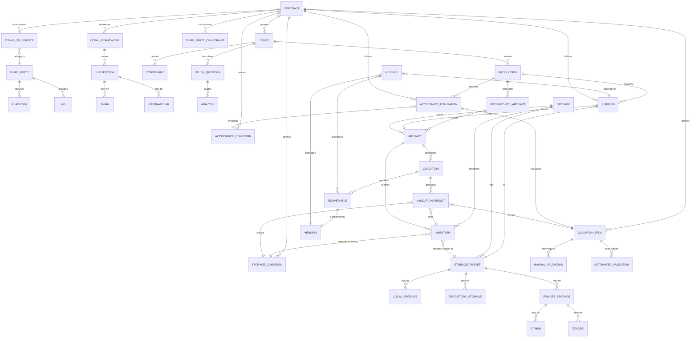

# 2026-10-16 plan — 採用済み ER 図（adopted draft）

**状態:** 採用済み（2026-10-16）。本ファイルは plan / adopted draft であり、正式仕様ではない。
**用途:** U3（validation ↔ storage の隣接 protocol）および DDD 文書更新の入力。ER 図は契約・規約/法令/第三者制約・研究・生産・出荷・保管先・目録・検証・成果物・リリースの関係を俯瞰するための草図であり、用語の正本化は DDD 側（`docs/specs/contracts.md`、`docs/domain/glossary.md`、`docs/domain/context-map.md` §4 U3、判断材料 `docs/domain/decision-briefs/U3-validation-storage-dependency.md`）で行う。

