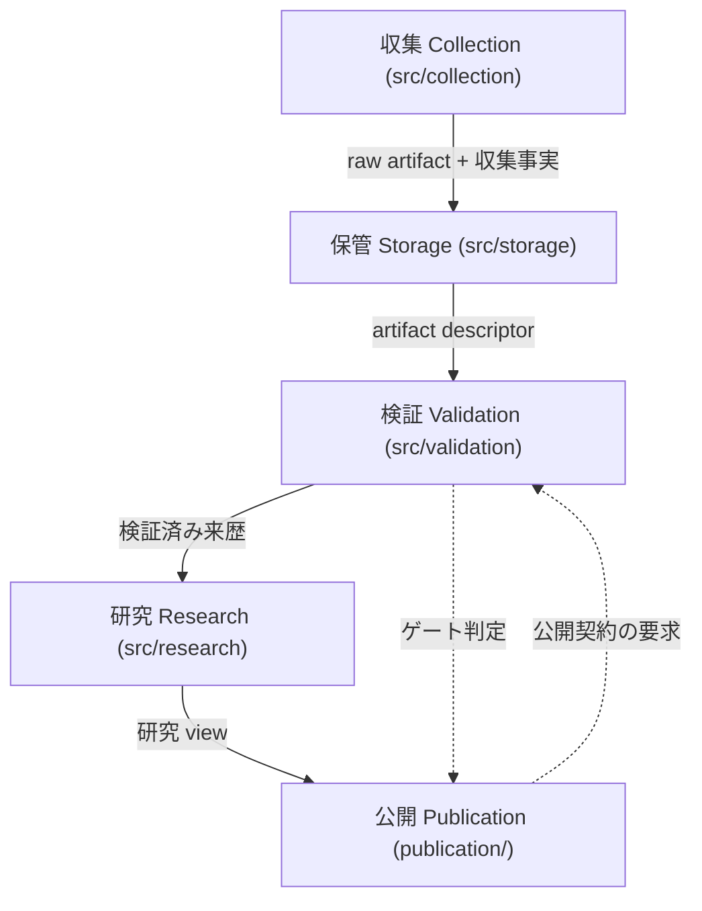

# publication 更新 計画書 — 契約（Cerberus）の整理・反映と、未反映データ（Google Trends / YouTube）の反映

| 項目 | 内容 |
|------|------|
| 作成日 | 2026-10-15（JST） |
| 対象 | `publication/`（実測 19 ファイル = 15 HTML + 4 Markdown。research 13 ページ、guide、`search-emergence-tracker/`、README）と、それを支える契約・検証 |
| 種別 | 実装前の計画書（作業指示書）。本ドキュメントではコード・データを変更しない |
| 関連 | `docs/specs/validation-framework.md`（契約フレームワーク正本）、`docs/specs/collection-pipeline.md`、`docs/reports/20261015b-*`、`docs/issues/20261015_p1_*.md` |

---

## 1. 目的

`publication/` を次の 2 点で更新する。

1. **契約の反映** — ケルベロス（Cerberus）検証パイプラインの契約を publication 層に反映する。あわせて、リポジトリ内で多義的に使われている**「契約」という用語自体を DDD 的に整理**する（メンテナ指示）。
2. **取得済みデータの反映** — すでに取得済みだが publication に反映されていない **Google Trends / YouTube の差分**を反映する。

---

## 2. 用語の確定（本計画の前提）

メンテナの指示による確定事項。本計画ではこの意味で使う。

| 語 | 本計画での意味 | 備考 |
|---|---|---|
| **契約** | ケルベロス（Cerberus）検証パイプラインの契約群。`docs/specs/validation-framework.md:3`「研究データ契約（G1〜G7）の構造検証フレームワーク」 | 現状は 18 スキーマ契約（同 §10 L324）+ registry + interface + gate が混在。「契約」の一語で 5 種を指している（本計画 §3.1） |
| **新しい契約** | 直近で追加された契約 — staging 宣言契約（`staging-declaration-v1`）、境界計測契約、CSV reader + `youtube-dataset-csv-v1`、公開審査 envelope（`publication-decision-v1`） | いずれも publication に未反映 |
| **新しいデータ** | 取得済みだが publication に反映されていない GT / YouTube の差分（§3.3） | 「未採用の生データ」ではなく「**取得済み・未反映**」を指す |

> 解釈の確認: 「契約の反映」を「**publication を契約に従わせる（公開契約の新設と検証）**」と読んだ。もし「**公開済みページのメタデータだけを契約形式へ揃える**」の意であれば §6 の範囲を縮小できる（§11-U1）。

---

## 3. 現状の実測（根拠つき）

### 3.1 契約側 — 「契約」が 5 種類を指している

| # | 種類 | 実体 | 宣言・実装の場所 | 版 | 検査 |
|---|------|------|------------------|----|------|
| 1 | スキーマ契約 | 18 件（`collection-run-v1` 等） | `src/validation/schemas/*.py`、`schema_registry.SCHEMA_VERSIONS` | すべて 1.0.0（`validation-framework.md` §10 L324） | Cerberus + contract test（`test_schema_coverage.py`） |
| 2 | レジストリ文書 | 11 ターゲット | `config/*.json`、`metadata/*/*.json` | 各文書の `schema_version` | `validate-registries`（実測 11 valid / exit 0） |
| 3 | インターフェース契約 | adapter / reader / staging 宣言 | `src/collection/core/contracts.py:50`（`ADAPTER_CONTRACT_VERSION = "1.0.0"`）、`src/storage/contracts.py:88`（`StorageReader`）、`src/collection/core/staging.py` | モジュール内定数 | 各 contract test |
| 4 | ゲート契約 | 収集前 / L1 後 / L2 比較可能性 / 公開 / 比較可能性 | `src/validation/{gates,pipeline,storage_policy,comparability}.py` | — | CLI（exit code + レポート） |
| 5 | 判断記録 | 公開審査 envelope | `metadata/publication/<artifact_id>/{artifact,evidence,decision}.json` | — | `gate-publication` + 監査レポート鮮度テスト |

- 責務分離の正本は `validation-framework.md` §7（L279-299）。「Cerberus は構造検証のみ」と明記されている。
- 実行時の構造検証の正本は Cerberus（`validation-framework.md` §11 L387-396）。JSON Schema は仕様記述として扱う。
- **用語の揺れの実例**: `validation-framework.md` §10 の表（L326）は列名が「契約」で、中身は `G1`〜`G7` / `P6` の**グループ記号**。同じ「契約」でスキーマ契約・レジストリ・グループを指しており、DDD 的な語彙整理が必要な状態。

### 3.2 publication 側 — 実測した欠陥

| # | 事実 | 根拠 | 影響 |
|---|------|------|------|
| P1 | 13 の research ページ全部が **Version 1.9.0 / DOI `zenodo.23164973`** を表示 | `publication/research_*.html` の引用ブロック | 現行リリースは **1.12.0 / `10.5281/zenodo.23253840`**（`CITATION.cff`）。`validate-version-sync.sh` は `guide_cbx_rewrite.html` のみ対象（実測 PASS 13 / FAIL 0）なので**検出されない** |
| P2 | 各 research ページに **YouTube Data API v3 由来**のセクションがある（`データソース: YouTube Search via Apify + YouTube Data API`、取得日 2026-10-09） | `publication/research_*.html` の 2 つ目の YouTube セクション | 2026-10-12 の方針判断で v3 は**使用しない**と決定し、v3 由来 run 55 件を raw から削除済み（`datasets/youtube-consistency/README.md:32-45`、`research/youtube/20261012-...md:19`）。**公開物が方針外ソースを出典として提示している** |
| P3 | GT セクションの構成がページごとに揃っていない。**5年表がない 7 ページ**（`cbg` / `cbn` / `crdp` / `hhc` / `hhch` / `thc` / `thch`）、5年のみ 1 ページ（`crdh`）、両方あり 5 ページ（`cbd` / `h4cbh` / `hhbd` / `thc-o` / `thcv`）。期間の記載自体が無いページもある | `grep -o '期間: 過去..'` と「5年データサマリー」の有無（実測）。例: `publication/research_thc.html:26-75` | 生成スキルは GT に 12ヶ月**と** 5年を必須としている（`.github/skills/generate-research-data-page/SKILL.md:113-143`） |
| P4 | 13 ページすべてで `id="data-youtube"` が **重複**（1 ページ 2 個） | `grep -c 'id="data-youtube"' publication/research_*.html` → 各 2 | HTML として不正。セクション単位の検査（`count_tables_in_section`）が両セクションを 1 つに連結して数える |
| P5 | ページ更新遅延を検出するはずの検証器が**不活性** | `scripts/validation/validate-research-pages.py:40-60`（`CONDITIONAL_SECTIONS`）、`:243`（ループ対象） | `DATA_DEPTH_REQUIREMENTS["data-search"]`（`5年`/`12ヶ月`/2 table 必須）は `CONDITIONAL_SECTIONS` に `data-search` が無いため**到達不能**。条件付きデータの存在判定パス `datasets/*/data/raw/{x,youtube}/...` も**存在しない**ため常に偽。結果、実測「13 合格 / イシュー 0 / 警告 0」を返す一方で P1〜P3 を見逃している |
| P6 | `publication/README.md:15` が**存在しないスキル** `.github/skills/update-cbx-guide/SKILL.md` を更新手順として案内 | `.github/skills/` 実測 32 件に `update-cbx-guide` なし | 更新手順が実行不能 |
| P7 | `publication/README.md:56` の未完了タスク「Instagram/TikTok データの反映」 | 同一ファイル | Instagram 定点は 2026-10-01 に廃止済み（`social-media-operations/research/teiten/HANDOVER.md` §4）。共有仕様 `docs/specs/instagram-tiktok-data-sharing-spec.md` は DRAFT のまま IG を含む |
| P8 | `guide_cbx_rewrite.html` のメタ不整合 | `:31` `dateModified: 2026-10-02` に対し `:209` `最終更新: 2026-10-01` | メタデータの単一正本がない |
| P9 | guide は X を「147件」として提示し、加えて「全フィールド（views, likes, reposts, replies, username, createdAt, text）147件中147件で欠損なし（100%）」と**投稿レコードの列構成に言及**している | `publication/guide_cbx_rewrite.html:481,983,1051` | 投稿単位の表現は禁止と決定（§6.5、2026-10-15）。同記述は修正対象。公開済み匿名化 CSV の取り下げ（`PUB-035`）は未決着 |

### 3.3 未反映データの差分

#### Google Trends（raw 29 run のうち、ページ記載より後のもの）

**確定で未反映**（`publication/` の最終更新は 2026-10-06 / 2026-10-08）:

| run / 成果物 | 内容 |
|---|---|
| `20261012T054920Z-google-trends-notation-presurvey` | 表記ゆれ 3 比較 |
| `20261012T055259Z-google-trends-ja-rikiddo-phase-a-12m` | 主要 5 語 ＋ リキッド、12ヶ月 |
| `20261012T060517Z-google-trends-ja-rikiddo-phase-a-repeat-12m` | 同条件再取得（非決定性の差分） |
| `20261012T061614Z-google-trends-ja-rikiddo-phase-b-12m` | 残り 8 語 ＋ JA-2〜JA-4 |
| `20261012T064246Z-google-trends-ja-rikiddo-5y-main5` | **5年 262 点 raw**（CBD/THC/CBG/CBN/HHC ＋ リキッド） |
| `research/google-trends/20261012-ja-rikiddo-expansion-report.md` | 取得レポート（GTJA-20261012） |
| `research_views/cbd-rikiddo-gt-weekly-parallel/` | G7 Research View（比較可能性レポート付き） |

**要突合**（日付は同日だが時刻がページ記載より後。ページは日付のみ記載のため判別不能）: `20261008T093228Z-google-trends-5y-baseline`（CBD/THC/CBG/CBN/HHC/THCV の 5年 summary）、`20261008T121338Z-google-trends-crdh-5y`、`20261008T164651Z-google-trends-common-scale-missing`。

#### YouTube

| 事実 | 根拠 |
|---|---|
| 収集ツールの正本は Apify Actor `h7sDV53CddomktSi5`（`streamers/youtube-scraper`）。v3 は使用しない | `datasets/youtube-consistency/README.md:13,32-45` |
| 一貫性検証は完了（同一クエリ 6 回で **39/39 = 100% 一致**） | 同 README `:8`、`research/youtube/20261012-...md:29-38` |
| CBD リキッド 2016–2019 月次（2016:17 / 2017:25 / 2018:53 / 2019:86、合計 181）と Apify 全期間の公開年分布（2021 ピーク 152 件）。**derived data のみ**、raw は削除済み | `research/youtube/20261012-...md:40-86` |
| 2026-10-14 に Apify dataset export **7 件**をダウンロード済み（未採用） | `~/Downloads/dataset_youtube-scraper_*.csv`。stage rehearsal の記録は `docs/reports/20261015b-youtube-csv-staging-driver.md`（record 数 24 / 224 / 395 / 456 / 468 / 352 / 393） |

---

## 4. スコープ

### 対象

- 成果物 1: 契約の DDD 整理（§5）
- 成果物 2: 新契約の publication 反映（§6）
- 成果物 3: 未反映データ（GT / YouTube）の反映（§7）
- 付随: `publication/README.md` の是正（P6 / P7）

### 非対象

- **ライブ収集**（GT の MCP 計測、Apify 実行、X 公式 API 接続）。いずれも別途承認・課金・資格情報が必要（`ISS-20261015-COL-031/032`、`ISS-20261015-PRV-033`）。
- 既存 raw・凍結 legacy 29 run・`src/validation/legacy.py` の変更、公開済みリリース（8 タグ・Zenodo）の書き換え。
- X 投稿単位データの公開可否の**決定**（同 §未確定 U4 / U5。決定はメンテナ）。
- Instagram 定点の再開（廃止済み）。

---

## 5. 成果物 1 — 契約の DDD 的整理

### 5.1 ねらい

「契約」を**境界づけられたコンテキストごとの、版を持つ検証可能な合意**として定義し、宣言場所・所有者・検査手段を 1 つの台帳に集約する。これにより §3.1 の 5 種混在を解消し、publication を契約の適用対象にできるようにする。

### 5.2 バウンズコンテキストとコンテキストマップ

AGENTS.md のパイプライン段階と `src/` パッケージを対応させる。



- **公開 Publication** は現在ソースコードを持たない（HTML と Markdown のみ）。本計画で**契約の適用対象として初めて明示されるコンテキスト**になる。
- 上流（収集・保管・検証）の契約は既存。下流にしか流れない関係を保つ（公開が上流の契約を書き換えない）。

### 5.3 ユビキタス言語（用語の定義と所有）

| 用語 | 定義 | 所有コンテキスト | 宣言場所 | 版 | 検査 |
|---|---|---|---|---|---|
| **契約 (Contract)** | 境界を越えて渡されるデータ／振る舞いについて、版を持ち機械検証可能な形で宣言した合意 | 検証 | — | — | — |
| スキーマ契約 | 文書形状の宣言 | 検証 | `src/validation/schemas/*.py` | `SCHEMA_VERSIONS` | Cerberus |
| レジストリ文書 | 契約対象の実体一覧（source / query / window / study 等） | 各コンテキスト（登録） | `config/`、`metadata/` | 文書 `schema_version` | `validate-registries` |
| インターフェース契約 | 実装が満たすべき型・振る舞い（adapter / reader / staging 宣言） | 収集・保管 | 各モジュール | モジュール定数 | contract test |
| ゲート契約 | 段階遷移の可否判定（収集前 / L1 / L2 / 公開 / 比較可能性） | 検証 | `src/validation/` | — | CLI + 監査レポート |
| 判断記録 | 人間の判断とその根拠（公開承認・証拠フラグ） | 公開 | `metadata/publication/` | — | `gate-publication` |

**命名・配置規則（新設）**

- 契約 ID は `<domain>-<object>-v<major>`（例: `collection-run-v1`、`staging-declaration-v1`）。
- 「契約」は総称としてのみ使い、個別文書の名前には使わない（`validation-framework.md` §10 表の「契約」列は **グループ (G1〜G7 / P6)** に改名）。
- registry 文書は `<layer>/<domain>/<object>.json`、schema は `src/validation/schemas/<object>.py` に 1 対 1 で対応させる。

**既存呼称との互換**: `G1`〜`G7` / `P6` は**別名として保持**する（`docs/plans/` の G 仕様書・既存イシュー・コードの docstring が参照しているため）。改名は行わず、対応表を新仕様に置く。

### 5.4 成果物

| ファイル | 内容 |
|---|---|
| `docs/specs/contracts.md`（新規） | 上記モデル。コンテキストマップ、ユビキタス言語、命名・配置規則、G1〜G7 対応表、契約追加手順 |
| `src/validation/contract_ledger.py` + `validation.cli contract-ledger`（新規） | `SCHEMA_VERSIONS`・registry・各モジュール定数から**機械的に**台帳を作る |
| `docs/audits/contract-ledger.json`（生成物） | 契約 ID / 所有コンテキスト / 宣言パス / 版 / 検査コマンド / テスト |
| `tests/validation/test_audit_report_freshness.py`（追記） | 台帳の再生成一致を固定（既存の監査レポートと同じ扱い） |

---

## 6. 成果物 2 — 新契約の publication 反映

### 6.1 公開契約（Publication Contract）の新設

公開コンテキストの契約を 1 つ定義し、**公開物が満たすべき宣言項目**を機械検査する。

| # | 要求 | 現状の違反 |
|---|---|---|
| PC-1 | リリース版と DOI が現行リリースと一致（全 HTML が対象） | P1（1.9.0 / 旧 DOI） |
| PC-2 | 各ページがデータ源を **run_id と取得日・窓**で参照する（どの run から出た数値か） | 現状は日付のみ。突合不能 |
| PC-3 | 方針外ソースを出典にしない（YouTube Data API v3）、X の投稿単位表現を含めない（§6.5） | P2、P9 |
| PC-4 | 宣言メタデータの単一正本（`dateModified` と `最終更新` の一致） | P8 |
| PC-5 | セクション構造の必須要件（GT は 12ヶ月と 5年、X は分類＋CI、YouTube は深度要件） | P3（7 ページで 5年欠落）、P5（検査不能） |
| PC-6 | HTML として妥当（重複 id なし） | P4 |
| PC-7 | 公開判断が `metadata/publication/` の判断記録として存在（証拠の引用つき） | 13 ページ分は未登録 |

### 6.2 実装方針（推奨）

- **実装済み（2026-10-15）**: 規則は `src/validation/publication_contract.py`、実行は
  `python -m validation.cli audit-publication`（**record-only**、常に exit 0、結果は
  `docs/audits/publication-contract.json`）。不活性だった `scripts/validation/validate-research-pages.py`
  は**削除**し、CI のステップ（`.github/workflows/research-validation.yml`）も監査へ差し替えた
  （規則の二重実装を作らないため）。
- PC-1 は既存 `scripts/validation/validate-version-sync.sh` の対象を `publication/*.html` 全体へ拡張する
  （版・DOI の正本は `CITATION.cff` / `metadata/datapackage.json`）。
  - **実装済み（2026-10-15）**: 公開 HTML 全体の版・DOI は `audit-publication` が検査する。
    `validate-version-sync.sh` 側は guide の DOI 比較が `${BASELINE_DOI%.*}` により任意の
    Zenodo DOI を通してしまうバグを修正した（README の同種チェックと同じ完全一致規則）。
- PC-3 は方針の語彙を `config/storage-policies.json` の `publication` 値に追加して表現する（現在は `requires_review` のみ。公開禁止・公開可の区別が語彙に無い）。
- 判断記録（PC-7）は既存 envelope 形式（`metadata/publication/README.md`）を再利用する。

### 6.3 依存（先に決着が必要）

- X の粒度は**決定済み**（§6.5）。残る依存は `ISS-20261015-PUB-035`（公開済み匿名化 CSV の取り下げ、U5）のみ。
- YouTube v3 由来記載（P2）の扱い: **削除** / 集計のみ残す / derived として明示、のいずれか（§11-U3）。

### 6.5 X 由来の公開表現の規則（X-PUB-1、2026-10-15 決定）

メンテナ決定: **投稿単位の表現は、リポジトリへの格納禁止と同じく禁止**。
施行先は 2 つある（`ISS-20261015-XID-034`）: 追跡・格納の禁止（既存方針）と、**公開物における表現の禁止**（本決定で追加）。

| 区分 | 内容 |
|---|---|
| 禁止 | 1 行 = 1 投稿の表・列挙、投稿本文の引用、投稿 ID / permalink、投稿日時の列、投稿ごとのエンゲージメント値、`username` / `author_id` の掲載、**投稿レコードの列構成に言及する記述**（例: フィールド別の完全率） |
| 許可 | 集計（件数・比率・分布・中央値等）、収集メタデータ（クエリ・期間・件数）、分類カテゴリ別の集計、収集の欠測/失敗状態 |
| 境界（確認） | 集計の単位を「分類 / 週 / 指標」に限り、**「1 行 = 1 アカウント」の表は投稿単位ではないが境界事例**として扱う（guide の「上位投稿者」表。現状は疑似名 A〜E で実名非公開。§11-U4b） |

- 施行: 公開契約の PC-3 として、`src/validation/x_identity.py` の検査対象に `publication/` を加える（permalink / `@handle` / 投稿単位の列見出しを機械検出）。非空虚性テスト必須。
- 本決定は「投稿単位データを**公開しない**」であり、集計値の公開は妨げない（AGENTS.md の集計公開方針と整合）。

---

## 7. 成果物 3 — 未反映データの反映

### 7.1 Google Trends

| 対象 | 反映内容 |
|---|---|
| 5年系列 | `20261008T093228Z-google-trends-5y-baseline`（6 化合物 summary。CBD/THC/CBG/CBN/HHC/THCV）と `20261012T064246Z-...-5y-main5`（CBD/THC/CBG/CBN/HHC ＋ リキッド、262 点 raw）から、**5年表を持たない 7 ページ**（`cbg` / `cbn` / `crdp` / `hhc` / `hhch` / `thc` / `thch`）へ 5年サマリー表を追加し、既存の 5年記載（`cbd` / `h4cbh` / `hhbd` / `thc-o` / `thcv` / `crdh`）は同じ run と突合して更新する（PC-5 の要件） |
| リキッド軸 | `20261012-ja-rikiddo-expansion-report.md` の 12ヶ月平均・初出週（HHC 2021-12-05、CBG 2024-02-04 など）を guide / 該当ページへ反映 |
| 限定事項 | 単独取得と比較取得のスケール不可比、低ボリューム語の断続表示、最新週の変動、`no-data` は **unknown**（需要ゼロと断定しない）を必ず併記 |
| 比較可能性 | 別 run・別言語間の数値比較を行わない旨を明記（`research_views/cbd-rikiddo-gt-weekly-parallel/` の comparability レポートと整合させる） |

#### 5 年表を持たない 7 ページの根拠状況（2026-10-15 実測）

5 年系列の run は存在するが、結果が「系列なし」の化合物がある。**未取得を 0 と書かない**ため、
run ごとに区別して記録する。

| ページ | 使える 5 年証拠 | 反映の仕方 |
|---|---|---|
| `cbg` / `hhc` / `thc` | `20261008T093228Z-google-trends-5y-baseline`（`cbg_5y_summary.json` 等） | 5 年平均・ピーク・最新値を表にする |
| `cbn` | `20261002T082000Z-google-trends-cbn-5y` → `no_series_observed` | 「5 年系列を取得したが Google Trends は系列を返さなかった（閾値以下）。
需要ゼロとは断定しない」と記録（`unknown`） |
| `crdp` | `20261002T085359Z-google-trends-crdp-5y` → `no_series_observed` | 同上 |
| `hhch` | `20261002T094730Z-google-trends-hhch-5y` → `no_series_observed` | 同上 |
| `thch` | **5 年 run が存在しない**（`20261002T064118Z-google-trends-thch` は 12ヶ月のみ） | 新規収集が必要（**ライブ GT 収集は未承認**）。それまでは「未取得」と記録し、
表を作らない |

なお `ja-rikiddo-5y-main5`（2026-10-12）は「○○ リキッド」クエリであり、単独クエリ
（`○○`）の 5 年系列とは**同一視しない**（別クエリ・別スケール）。リキッド軸は guide と
該当ページで別途扱う。

### 7.2 YouTube

| 対象 | 反映内容 |
|---|---|
| X セクション | 投稿単位の表現を含めない（§6.5、決定済み）。guide の「データ完全率」記述（`:1051`）は**投稿レコードの列構成に言及**するため修正対象。上位投稿者表は境界事例（§11-U4b） |
| v3 由来セクション | 方針判断（2026-10-12）に従い撤回または derived 明示へ置換（§11-U3）。**投稿日は v3 由来**である点を必ず記録 |
| 正本の変更 | YouTube の正本は `datasets/youtube-consistency`（Apify `h7sDV53CddomktSi5`）であることをページと README に明記 |
| 新データ | 一貫性（39/39 = 100%）と CBD リキッド 2016–2019 タイムライン・公開年分布（2021 ピーク 152）を CBD ページへ反映（**derived のみ**、raw は削除済み＝再現不可の一次性派生値であることを明記） |
| 未採用 7 export | 反映には**採用判断が先**（`ISS-20261015-COL-017` の確認 4 点: run/dataset ID、`dateFilter`、run status、ファイル名 timestamp の timezone）。採用時は CSV のまま stage → adopt → 検証の手順（`docs/specs/collection-pipeline.md` §3.4） |

### 7.3 生成方法（手編集しない）

- ページは既存スキル `.github/skills/generate-research-data-page/`（`generate_research_data_page.py`）、guide は `generate-compound-guide/` で生成し、**数値の出所（run_id）を記録**する。
- 手作業が避けられない箇所は、変更内容・理由・日時・担当を追記する（AGENTS.md 再現性）。
- 数値は raw から再計算する。既存の記載値を「きれいに見せるため」に調整しない。

### 7.4 付随（`publication/README.md`）

- 更新手順から存在しないスキル参照（P6）を除き、実在するスキル／コマンドへ差し替える。
- Instagram/TikTok の未完了タスク（P7）を、IG 廃止（2026-10-01）と TikTok 共有の現状に合わせて書き直す。
- データソース表を run_id 付きに更新（PC-2）。

---

## 8. 実施順序

| 段階 | 内容 | 依存 |
|---|---|---|
| 0 | 計画の承認と §11 の未決事項の決定 | メンテナ |
| 1 | 契約の DDD 整理（§5）。台帳の生成と固定 | — |
| 2 | 公開契約の実装（§6.1/6.2）。検査の復活（P5）と版・DOI の整合（P1） | 段階 1、U1 |
| 3 | YouTube v3 記載の処理（§7.2）と X セクションの確定 | U3、U4、U5 |
| 4 | GT / YouTube 差分の反映（§7.1/7.2） | 段階 2 |
| 5 | README 是正（§7.4）と全ゲート再実行（§9 の検収） | 段階 2-4 |

段階 1・2 は §11 の未決が残っていても着手できる。段階 3・4 は決定待ち。

---

## 9. 検収

各段階で実行し、結果を記録する（現行の green を維持する）。

```bash
.venv/bin/python -m pytest -q                                          # 1014 passed（現行）
.venv/bin/python -m validation.cli validate-registries                 # 11 target valid / exit 0
.venv/bin/python -m validation.cli audit-issues                        # open_p0=0 / failures=0
.venv/bin/python -m validation.cli audit-new-runs                      # 29 run / failures=0
.venv/bin/python -m validation.cli audit-x-identity                    # findings=0
.venv/bin/python -m validation.cli contract-ledger                     # 新規。台帳を再生成
.venv/bin/python -m validation.cli gate-publication ...                # 公開判断の再実行（PC-7）
bash scripts/validation/validate-version-sync.sh                       # FAIL 0（PC-1）
bash scripts/validation/validate-data-schema.sh
.venv/bin/python -m validation.cli audit-publication                    # 公開契約（record-only、findings を記録）
```

> 2026-10-15 の実測: `audit-publication` は 15 artifact・**48 findings**
> （PC-1 39 ＝ 13 ページの版・DOI、PC-5 9 ＝ GT 5 年表 8 + guide の X 信頼区間 1）。

完了条件: PC-1〜PC-7 がすべて機械検査で PASS し、かつ**検査器が意図的に失敗させたときに落ちる**こと（非空虚性。P5 の再発防止）。

---

## 10. リスクと対策

| # | リスク | 対策 |
|---|--------|------|
| R1 | 契約の改名で既存文書・コードの参照が壊れる | G1〜G7 を別名として保持し、改名しない（対応表のみ追加） |
| R2 | 公開契約が「記録のみ」で実効性を持たない | 検査を CI に接続し、非空虚性テストで固定（§9） |
| R3 | v3 由来セクションの撤回でページの数値が減る | 撤回理由と日付を公開物内に明記（欠測 ≠ ゼロ。AGENTS.md） |
| R4 | 反映漏れ（同日の run の取り違え） | PC-2 により run_id を必須にし、突合を機械化（§3.3 の「要突合」を解消） |
| R5 | 公開済みリリースの書き換え | 既存タグ・Zenodo アーカイブは変更せず、新コミット → CHANGELOG → 新リリースで対応 |

---

## 11. 未決事項（確認依頼）

| # | 論点 | 選択肢（推奨） |
|---|---|---|
| U1 | 「契約の反映」の範囲 | (a) 公開契約を新設して publication 全体を契約下に置く（**推奨**）／(b) 既存ページのメタデータだけ整える |
| U2 | 版・DOI の付与方法 | (a) `CITATION.cff` を単一正本として検査（**推奨**）／(b) 各ページに直書きを維持しつつ検査のみ |
| U3 | v3 由来 YouTube 記載の扱い | (a) 撤回／(b) derived として明示して残す（**推奨: (b)** 理由: 取得済み事実は証拠であり、出典と限界を明示すれば保持できる）／(c) 全面差し替え |
| U4 | X 集計の公開粒度 | **決定済み（2026-10-15）**: 投稿単位の表現は格納禁止と同じく禁止（§6.5）。追加の決定は不要 |
| U4b | アカウント単位の表（guide「上位投稿者」、疑似名 A〜E）の可否 | (a) 維持（**推奨**。単位がアカウントであり投稿単位ではない。疑似名化済み・実名非公開。ただし規則の境界にあることを公開物内に明記）／(b) 集計へ畳む（「販売系アカウントが上位」等の定性記述のみ残す） |
| U5 | 公開済み匿名化 CSV（8 タグ・Zenodo を含む）の取り下げ要否 | `ISS-20261015-PUB-035` |
| U6 | 未採用 7 export の採用可否 | `ISS-20261015-COL-017` の確認 4 点が先 |
| U7 | Instagram/TikTok の扱い | (a) 共有仕様を TikTok のみに改訂（**推奨**）／(b) 仕様を ARCHIVED 化 |
| U8 | 本計画書の置き場所 | (a) `docs/reports/`（**現状の配置**。`docs/plans/` は gitignore のため追跡されない）／(b) 承認後に `docs/issues/` へ追跡イシュー化 |

---

## 12. 変更履歴

| 日付 | 内容 | 承認 |
|------|------|------|
| 2026-10-15 | 初版作成（契約の DDD 整理、新契約の publication 反映、GT / YouTube 差分反映の計画） | 未 |
| 2026-10-15 | U4 決定を反映: 投稿単位の表現を公開物でも禁止（§6.5 X-PUB-1）。§6.3 の依存を PUB-035 のみに縮小。P9 / PC-3 / §7.2 を更新 | メンテナ決定（U4） |
| 2026-10-15 | 実施①（段階 1・2）: 契約のドメインモデルと台帳、公開契約の規則と record-only 監査。不活性な検証器を削除 | メンテナ（その他は進めてよい） |
| 2026-10-15 | 実施②（段階 3）: 重複 id 13 件、v3 出典の明示 13 件、guide のメタ（版・DOI・dateModified）、
X の投稿レコード記述を修正。`validate-version-sync.sh` の DOI 比較の真空性を修正 | 同上 |
| 2026-10-15 | 実施③（段階 5）: `publication/README.md` の更新手順と未完了タスクを実態に合わせ、監査コマンドを記載 | 同上 |
