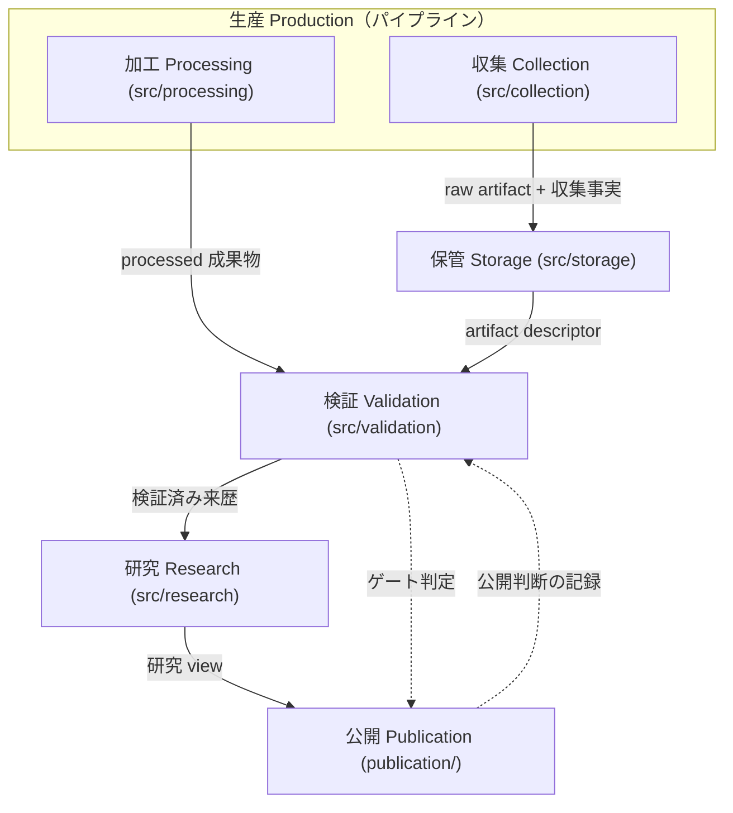

# 契約（Contract）のドメインモデル

**版:** 1.2.2（2026-10-16）
**目的:** リポジトリ内で多義的に使われてきた「契約」を、境界づけられたコンテキストごとの
**版を持つ検証可能な合意**として定義し、宣言場所・所有者・検査手段を 1 つの台帳に集約する。
併せて、**パイプライン**をドメイン上 **生産 (Production)** として定義し、判定側（検証）
との分離を規則にする（§3.1）。
**関連:** `docs/specs/validation-framework.md`（Cerberus の正本）、
`docs/specs/collection-pipeline.md`（パイプラインの運用契約）、
`docs/reports/20261015c-publication-refresh-plan.md`（導入の経緯）、
`docs/audits/contract-ledger.json`（本モデルの機械生成台帳）

---

## 1. なぜ必要か

「契約」は同じ語で **5 種類の宣言**を指していた。

| 問題だったこと | 実測 |
|---|---|
| スキーマ契約とグループ記号が同じ語で呼ばれていた | `validation-framework.md` §10 の表は列名が「契約」で、中身は `G1`〜`G7` / `P6` |
| 一覧がどこにも無かった | 18 スキーマ + 11 registry + adapter / reader 契約 + 6 ゲートが散在 |
| 版の有無がまちまちだった | スキーマは `SCHEMA_VERSIONS`、adapter は `ADAPTER_CONTRACT_VERSION`、ゲートは未宣言 |
| 公開層は契約の外にあった | publication の成果物はどの契約にも登録されず、版・DOI がリリースと乖離しても検出できなかった |

本仕様はこの 4 点を 1 つのモデルと 1 つの台帳で解消する。

---

## 2. ユビキタス言語

| 用語 | 定義 | 所有コンテキスト | 宣言場所 | 版 | 検査 |
|---|---|---|---|---|---|
| **契約 (Contract)** | 境界を越えて渡されるデータ／振る舞いについて、版を持ち機械検証可能な形で宣言した合意 | 検証 | — | — | — |
| **生産 (Production)** | **パイプライン**。上流の入力から契約準拠の**記録**（run / artifact / 加工成果物 / 生成値）を産出する側（収集・加工）。判定はしない（§3.1） | 生産 | `src/collection/`、`src/processing/` | モジュール定数（`ADAPTER_CONTRACT_VERSION` 等） | 検証側が判定する（`gate-run` / `audit-new-runs` / `audit-processed`） |
| **スキーマ契約** | 文書形状の宣言（必須項目・型・列挙・余分なフィールド） | 検証 | `src/validation/schemas/*.py`、`schema_registry.SCHEMA_REGISTRY` | `SCHEMA_VERSIONS` | Cerberus（`validate-*`）、`test_schema_coverage.py` |
| **レジストリ文書** | スキーマ契約が検証する実体一覧（source / query / window / study 等） | 産出したコンテキスト | `config/`、`metadata/` | 文書の `schema_version` | `validation.cli validate-registries` |
| **研究 (Study)** | 研究質問・対象範囲・入力証拠・処理方法・成果物・制約を 1 つに束ねる研究単位。実装上の ID は `study_id`、配置は `datasets/<study-id>/`。HTML ページや release ではなく、dataset release の根拠になる研究集約 | 研究 | `datasets/<study-id>/README.md`、`methodology.md`、`metadata/studies/study-registry.json` | 文書の `schema_version` / release version | `research.cli audit-studies`、`validate-registries`、`audit-processed` |
| **インターフェース契約** | 実装が満たすべき型・振る舞いの宣言 | 収集・保管 | `collection/core/contracts.py`、`collection/core/staging.py`、`storage/contracts.py` | モジュール定数 | 各 contract test |
| **ゲート契約** | 段階遷移の可否判定 | 契約 | `src/validation/`、`src/research/`（宣言場所。所有とは分離する） | （未宣言。§10） | 検証・研究の CLI + 監査レポート |
| **判断記録** | 人間の判断と根拠（公開承認・証拠フラグ） | 公開 | `metadata/publication/<artifact_id>/` | — | `validation.cli gate-publication` |

「契約」は**総称としてのみ**使う。個別の文書名には使わない（`collection-run-v1` であって
`collection-run契約` ではない）。

### 2.1 コンテキスト別の読み方

| コンテキスト | 「契約」と呼んでいるもの |
|---|---|
| 生産 Production（パイプライン） | plan（スキーマ・レジストリ）、query、temporal window、adapter インターフェース、staging 宣言。産出はするが判定しない |
| 収集 Collection（生産の下位） | source / collector / 収集 run の記録 |
| 加工 Processing（生産の下位） | 派生成果物の導出宣言と生成値 |
| 保管 Storage | artifact manifest、artifact registry、storage policy、reader インターフェース |
| 検証 Validation | スキーマ契約全体（検査・行使）、監査。ゲート契約は検査・行使のみ（所有は契約） |
| 研究 Research | **研究 (Study)**、transformation 来歴、evidence、measurement / research view |
| 公開 Publication | publication decision（判断記録） |
| 契約 Contract（統治基盤） | ゲート契約（所有。検査・行使は検証・研究が分担）。唯一の台帳の提供 |

---

## 3. バウンズコンテキストとコンテキストマップ

AGENTS.md のパイプライン段階と `src/` パッケージを対応させる。段階のうち
**記録を作る側**を 1 つのコンテキスト **生産 (Production)** にまとめ、**判定する側**
（検証）と対置する。

### 3.1 生産（パイプライン）

| 項目 | 内容 |
|---|---|
| ドメイン名 | **生産 (Production)** |
| コード名 | **パイプライン**（`collection.core.pipeline` / `collection.core.cli`） |
| 産出物 | 収集 run（`collection-run-v1`）、staged run、catalog 配置、加工成果物（`data/processed/`）、公開ページに載る生成値（`processing.cli gt-summary`） |
| 実装 | `src/collection/`（pipeline / staging / adapters）、`src/processing/` |
| 宣言場所 | 実装モジュール（plan・宣言ファイル・adapter 契約） |
| 検査 | 検証コンテキスト（L1 = `validation.cli gate-run`、`audit-new-runs`、`audit-processed`） |

規則:

1. **生産は判定しない。** 産出側は staging（`.staging/<run-id>/`）までを行い、
   採用・隔離（catalog / quarantine）は L1 判定が決める。gate が自分の入力を
   生成するコードに依存しない（`docs/specs/collection-pipeline.md` §3.3、P5）。
2. **検証は産出しない。** 検証コンテキストはレポートを書くが、収集記録・加工成果物は
   作らない。
3. 生産の出力は**記録**（run / artifact / 派生表）であって解釈ではない。解釈は
   研究・公開のコンテキストにある（AGENTS.md: 観測と解釈の分離）。

「パイプライン」は実装（モジュール・CLI）の名前、「生産」はドメインの名前である。
AGENTS.md の段階列（SOURCE → … → PUBLICATION）は生産・保管・検証・研究・公開を
またぐ**全体フロー**で、本コンテキストはその産出側だけを指す。

### 3.2 コンテキストマップ



- 上流の契約は下流にしか流れない（公開が収集の契約を書き換えない）。
- 公開は現在ソースコードを持たない（HTML と Markdown）。それでも契約の適用対象として
  他のコンテキストと同じように扱う（判断記録は `metadata/publication/`）。
- 台帳（§8）の `owner` は**所有コンテキスト**を記録する（現在は
  `collection` / `storage` / `research` / `publication` / `validation` に加え、
  ゲート契約の所有を示す `contract`）。生産は
  `collection` と `processing` をまとめた上位名なので、`owner` の値は改名しない。
  ゲート契約の `owner` は `contract` とする。宣言場所（`src/validation/` /
  `src/research/`）と検査・行使（検証・研究の CLI）は所有と分離する（§4）。

---

## 4. 所有の規則

1. **owner = 成果物を産出するコンテキスト**（検証するコンテキストではない）。
   - 例: `collection-run-v1` の owner は `collection`（run 記録を書くのは収集）。
2. **検証はすべてのスキーマ契約の enforcer**。所有者と検査者が別であることを許す。
3. owner / グループの決定は省略できない。新しいスキーマを登録すると、
   `tests/validation/test_contract_ledger.py` が「該当エントリが無い」で落ちる。
4. **ゲート契約の owner は契約**。検証・研究は検査・行使を分担する
   （AGENTS.md Domain Language）。宣言場所が `src/validation/` /
   `src/research/` にあっても所有は変わらない。

---

## 5. DDD との対応（分類であり、改名ではない）

リポジトリの実体を DDD の語で**分類**する。既存のファイル名・ID は変えない。

| DDD の語 | 本リポジトリでの実体 |
|---|---|
| 集約 (aggregate) | レジストリ文書（`metadata/queries/query-registry.json` など）と **研究 (Study)**。研究の集約ルートは `datasets/<study-id>/README.md` / `methodology.md` / `metadata/studies/study-registry.json` の組で、配下の processed artifact・schema・validation record を束ねる |
| 値オブジェクト | `run_id`、`window_id`、`artifact_id`、`sha256`、capability の三値、契約の版 |
| ドメインイベント | 収集実行の確定（`run_metadata.json`）、成果物の登録（artifact manifest）、証拠の記録（evidence registry）、公開判断（publication decision） |
| 不変条件 | 付録 A の規則（raw 不変、欠測 ≠ ゼロ、記録の再生成一致） |
| コンテキストマップ | §3（上流→下流の一方向） |

付録 A は AGENTS.md の不変条件を再掲しない。**契約として機械検査される不変条件**だけを
ここに置く（それ以外は AGENTS.md が正本）。

### 付録 A: 機械検査される不変条件

| # | 不変条件 | 検査 |
|---|---|---|
| A1 | `schema_version` は登録された契約バージョンと一致する（CV-20） | `validation.semantic.check_schema_version` |
| A2 | 登録スキーマには対応する Contract Test がある | `tests/validation/test_schema_coverage.py` |
| A3 | 凍結 legacy run 以外は現行契約を満たす | `validation.cli audit-new-runs` |
| A4 | 監査レポートは再生成結果と一致する | `tests/validation/test_audit_report_freshness.py` |
| A5 | 契約台帳は再生成結果と一致し、全スキーマを含む | `tests/validation/test_contract_ledger.py` |
| A6 | reader は未実装モードを近似せず `UnsupportedRead` を返す | `tests/validation/test_storage_contract.py` |
| A7 | adapter は registry が記録した capability を発明しない | `tests/collection/test_adapter_contract.py` |

---

## 6. 命名・配置の規則

- 契約 ID: `<domain>-<object>-v<major>`（`collection-run-v1`、`staging-declaration-v1`）。
- スキーマ契約: `src/validation/schemas/<object>.py` + `SCHEMA_REGISTRY` 登録 + Contract Test。
- レジストリ文書: `config/<object>.json` または `metadata/<domain>/<object>.json`。
  検証対象にするには `validation.cli` の `REGISTRY_FILES` / `METADATA_REGISTRY_FILES` に加える
  （台帳はこの 2 つをそのまま読む）。
- インターフェース契約: 実装モジュール内の定数 + Contract Test。
- ゲート契約: CLI サブコマンド 1 つ = 判定 1 つ。

---

## 7. 既存呼称（G1〜G7 / P6）との対応

`G1`〜`G7` / `P6` は**別名として保持**する（`docs/plans/` の G 仕様書・イシュー・docstring が
参照しているため）。改名しない。台帳の `group` 列がこの別名を持つ。

---

## 7.1 公開契約（PC-1〜PC-8）

公開層の機械検査は `validation.cli audit-publication` が担当する。これは record-only であり、
公開・Release・Zenodo 操作は行わない。

| ID | 機械検査すること | 備考 |
|---|---|---|
| PC-1 | release version / DOI が `CITATION.cff` と `metadata/datapackage.json` の宣言に一致する | HTML 全体 |
| PC-2 | 研究ページの Google Trends 5 年表が run を名乗り、名乗った run が catalog に存在する | 研究ページ限定 |
| PC-3 | policy-out source（YouTube Data API v3）と X 投稿単位表現を検出する | 投稿単位 X 表現は禁止 |
| PC-4 | JSON-LD の `dateModified` と本文の `最終更新` が一致する | 両方がある場合 |
| PC-5 | 研究ページの section depth（GT 12ヶ月+5年、X 95% CI、YouTube depth） | `research_*.html` 限定 |
| PC-6 | HTML の `id` が重複しない | HTML 全体 |
| PC-7 | `metadata/publication/<artifact_id>/` の review envelope が存在し、path / sha256 / decision state を固定する | `requires_review` は公開可ではない |
| PC-8 | guide 固有の構造（JSON-LD、H1、主要 section、開示 marker、FAQ 4 問以上） | `guide_*` 限定 |

PC-7 は判断状態の**記録**を検査するだけで、承認を発明しない。対象 publication はまだ公開していないため、
現時点の HTML artifact は `decision.status = "requires_review"` で記録する。実際の公開可否は
`validation.cli gate-publication` の PUB-10（`approved` + 同一 sha256）で判定する。

---

## 8. 台帳（唯一の一覧）

```bash
python -m validation.cli contract-ledger                     # 一覧（text）
python -m validation.cli contract-ledger --format json
python -m validation.cli contract-ledger --output docs/audits/contract-ledger.json
```

`docs/audits/contract-ledger.json` は生成物であり、`test_audit_report_freshness.py` が
再生成一致を検査する。台帳は次を **宣言から** 導出する（手書きしない）。

| 区分 | 導出元 |
|---|---|
| スキーマ契約 | `SCHEMA_REGISTRY` / `SCHEMA_VERSIONS` |
| レジストリ文書 | `REGISTRY_FILES` / `METADATA_REGISTRY_FILES` + `metadata/windows/*.json` + `metadata/publication/*/` |
| インターフェース契約 | `validation.contract_ledger._interface_contracts()` |
| ゲート契約 | `GATE_CONTRACTS` |
| ギャップ | 未宣言のスコープ / 版、存在しない宣言先、存在しない文書 |

2026-10-15 の実測: **28 契約（スキーマ 19 / インターフェース 3 / ゲート 6）、文書 12、ギャップ 7**。

---

## 9. 契約の追加・変更手順

1. スキーマ契約: スキーマを `src/validation/schemas/` に追加し、`SCHEMA_REGISTRY` と
   `SCHEMA_VERSIONS` に登録、**同じ変更で** `SCHEMA_SCOPE`（owner / group）を決める。
   Contract Test を追加する。
2. レジストリ文書: `REGISTRY_FILES` / `METADATA_REGISTRY_FILES` に加え、
   `validate-registries` と CI が検証することを確認する。
3. インターフェース契約: 実装モジュールに版定数を置き、`_interface_contracts()` に追加する。
4. ゲート契約: CLI サブコマンドを追加し、`GATE_CONTRACTS` に追加する。
5. いずれの場合も `python -m validation.cli contract-ledger --output docs/audits/contract-ledger.json`
   を再生成し、`pytest tests/validation/test_contract_ledger.py` を通す。
6. 版を上げる場合は `validation-framework.md` §9 のスキーマ更新ルールに従う。

---

## 10. 既知のギャップ（2026-10-15 時点、台帳の実測）

| # | ギャップ | 状態 |
|---|---|---|
| G1 | ゲート契約 6 件に契約バージョンが無い | **未宣言のまま維持（意図的に open、owner決定 2026-10-16・案C）。推測で付けない。正式トリガー（T1 意味変更：合否意味・必須条件・failure / warning の扱い変更／T2 並存：同一 gate 名の複数判定基準の同時保持・実行・参照／T3 引用：外部公開・DOI・論文・第三者監査での固定識別子引用の必要）のいずれか成立時に owner が版付与を再判断する。全文は `docs/domain/decision-briefs/U4-gate-contract-version.md` §3**。なお、リリース（配布単位・配布行為）するから gate version が必要になるわけではない |
| G2 | reader インターフェース契約に版が無い（各 reader は `reader_version` を持つ） | 同上。契約自体の版が必要かは別途判断 |

ギャップは台帳が導出する（宣言を直せば消える）ため、ここに手で維持する一覧は置かない。

---

## 11. 変更履歴

| 日付 | 版 | 内容 |
|---|---|---|
| 2026-10-16 | 1.2.2 | U4 案C（未宣言維持＋トリガー正式化）の owner 決定を §10 に同期。G1 は意図的に open のまま残し、再判断トリガー T1–T3 を記録 |
| 2026-10-16 | 1.2.1 | ゲート契約の所有を契約に同期（§2・§2.1・§3.2・§4規則4）。U2 の正本同期を完了し、台帳 `GATE_CONTRACTS` の owner を `contract` に更新 |
| 2026-10-15 | 1.2.0 | §7.1 に公開契約 PC-1〜PC-8 の機械検査範囲を追加。PC-7 の review envelope と PC-8 の guide 構造検査を実装済みとして記録 |
| 2026-10-15 | 1.1.0 | §3 を「生産（パイプライン）とコンテキストマップ」に拡張。**パイプライン**をドメイン上 **生産 (Production)** と定義し、判定側との分離を規則化（§3.1）。ユビキタス言語と §2.1 に 生産 / 下位コンテキストを追加 |
| 2026-10-15 | 1.0.0 | 初版。5 種の宣言をモデル化し、台帳 `validation.cli contract-ledger` と `docs/audits/contract-ledger.json` を導入 |
